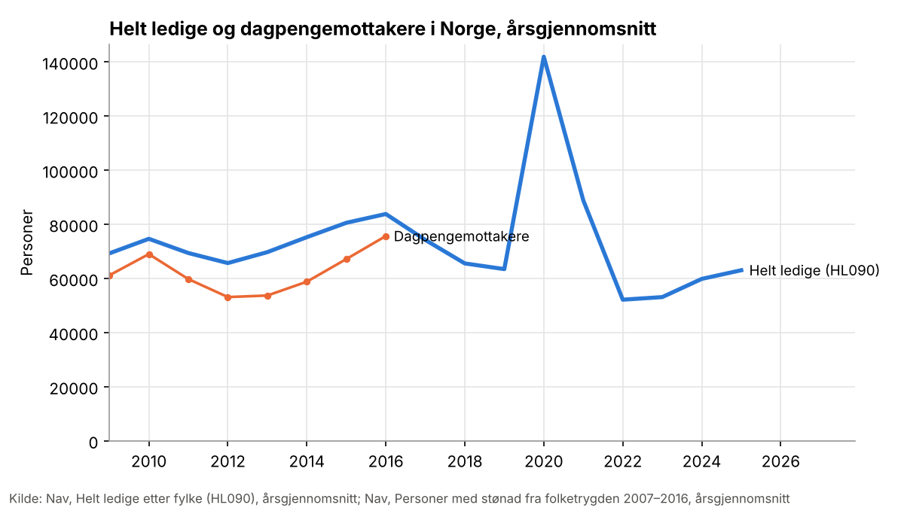
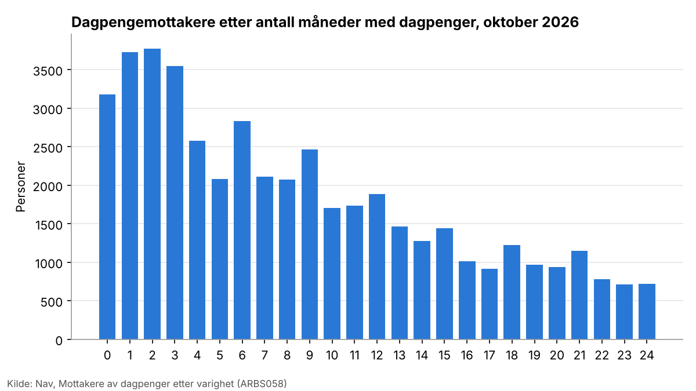
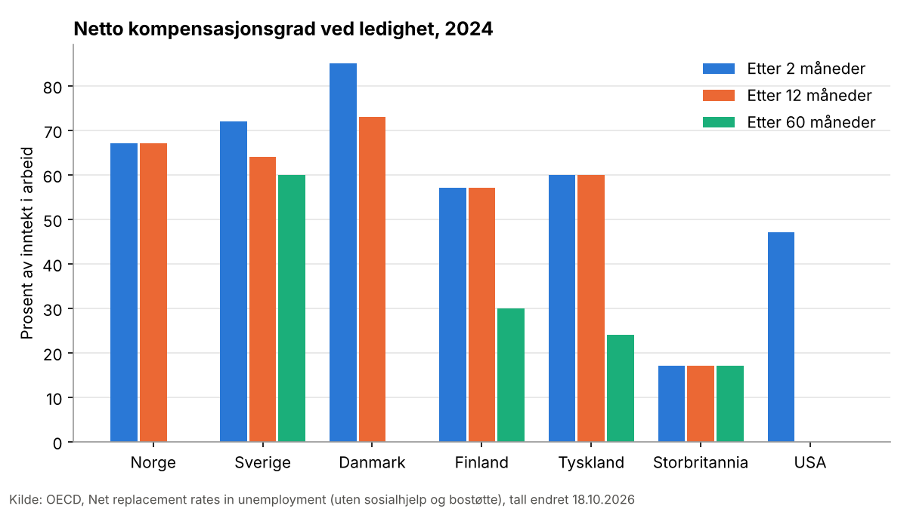

# Dagpengenes varighet og nivå og overgangen til arbeid: hva viser forskningen?

**Status: utkast, ukontrollert.** Laget 10.11.2026. Tallene er hentet ut av Claude og kontrollert mot sitat og side, men ikke av en fagperson. Hovedkonklusjonen er en vurdering av studiene og bør leses av en fagperson før den brukes videre. Det er forskning, ikke lov eller forskrift.

**Spørsmålet** (mandat godkjent av bestilleren 10.11.2026): Hvordan påvirker hvor lenge man kan få dagpenger, og hvor høye de er, hvor raskt ledige kommer i arbeid og hvor gode jobbene blir?

**Kildegrunnlaget.** Søket i internasjonale, norske, svenske og finske kataloger, tre runder med referanser og to blinde utvalg ga et utvalg på om lag åtte hundre og åtti studier. Etter avtale med bestilleren er tallene hentet ut for kjernen: oversikter, studier i kategori 1–3 (forsøk, reformer og naturlige eksperimenter) og alle nordiske studier, til sammen fire hundre og fem kilder. To hundre og tretten av dem er lest i fulltekst, og hundre og nittito bare i sammendrag. Registerstudier i kategori 4–5 utenfor Norden er bare listet i vedlegget. Alle tall står med sitat og side i vedlegg A.

**Reproduserbarhet.** Søk 10.11.2026. Commiten for katalogene står i `utvalg.md`. Første utvalg, første uttrekk og første blinde utvalg med Opus, andre blinde utvalg og andre uttrekk med Sonnet, grovsikting med Haiku. Hundre og nittito av kjernekildene er bare lest i sammendrag.

## Kort svar

Både lengre dagpengeperiode og høyere dagpenger gjør at ledige bruker noe lengre tid på å komme i arbeid. Effekten er godt dokumentert og moderat. For perioden er effekten per uke liten og ganske lik mellom de beste studiene. For nivået er elastisitetene større, men spriker mer mellom studiene.

- **Periode.** Campbell-oversikten over europeiske studier finner at kortere dagpengeperiode øker overgangen til arbeid med om lag 10 prosent (hasardrate 1,10, 95 prosent KI 1,03–1,17) ([Filges mfl. 2018](https://openalex.org/W2963969083)). I europeiske studier gir én måned lengre periode i median 0,13 måneder lengre tid uten arbeid, altså om lag fire dager ([Schmieder og von Wachter 2016](https://openalex.org/W2892364420)).
- **Nivå.** Elastisiteten av ledighetsvarigheten med hensyn til dagpengenivået ligger i median på 0,53 i studiene ([Schmieder og von Wachter 2016](https://openalex.org/W2892364420)). En metaanalyse finner at publiseringsskjevhet overdriver effektene, mest for perioden: korrigert gjennomsnittlig elastisitet er 0,09 for periode (ukorrigert 0,46) og 0,21 for nivå (ukorrigert 0,43) ([Cohen og Ganong 2024](https://openalex.org/W4401689619)). Metaanalysen er et arbeidsnotat, og de korrigerte tallene avhenger av metoden.
- **Norge.** Kuttet i maksimal periode fra tre til to år i 2003 ga kortere ledighet for dem med inntekt over 2 G, med 0,23 uker per uke kortere periode, og om lag to prosentpoeng flere i jobb etter fire år ([Falch mfl. 2012](https://kudos.dfo.no/dokument/7d037e12-1538-4c97-9339-fb49dd5e5502)). De norske studiene peker samme vei som de utenlandske, men har middels troverdighet, bygger på data fra 1990- og 2000-tallet, og én finner ingen signifikant effekt for dem som mistet retten ([Falch mfl. 2011](https://kudos.dfo.no/dokument/cf803acc-e73d-410f-a09f-e4633c73602a)).
- **Jobbkvalitet.** Bildet er blandet. Campbell-oversikten finner ingen forskjell i lønn eller hvor lenge den nye jobben varer ([Filges mfl. 2018](https://openalex.org/W2963969083)). Enkeltstudier spriker i fortegn, men effektene er små: litt høyere lønn med lengre periode i Østerrike, Finland og Norge, litt lavere lønn i Tyskland fordi ledigheten varer lenger, og flere midlertidige jobber med kortere periode i Nederland.
- **Søkeatferd.** Overgangen til arbeid øker rett før dagpengene går ut, men toppen er mindre enn mange har trodd, og en del av den er overgang til andre ytelser eller ut av registeret. Ledige kjenner ofte ikke sin egen periode.
- **Konjunktur og grupper.** Amerikanske studier finner at høyere nivå gir mindre forlengelse av ledigheten i nedgangstider, mens en tysk studie av perioden ikke finner noen forskjell. Eldre reagerer sterkere på lengre periode, blant annet fordi den kan bli en vei til pensjon. Permitterte reagerer annerledes enn oppsagte, fordi mange går tilbake til samme arbeidsgiver. For dem ser arbeidsgivers lønnsplikt ut til å bety mer enn dagpengene, men det finnes ingen troverdige effektmål.
- **Samfunnseffekten** av forlengelser er omstridt. Studier av USA etter finanskrisen spriker fra nær null til store effekter på ledighetsraten.

## Statistikk

Statistikken beskriver nivå og utvikling og sier ingenting om effekt. Tallene er hentet fra datakatalogen 10.11.2026 og kan bli revidert.

**Antall.** I oktober 2026 fikk 46292 personer dagpenger (Nav, ARBS058). Nav-serien over dagpengemottakere i datakatalogen går bare til 2016, da det i snitt var 75668 mottakere (Nav, stønadsmottakere 2007–2016). Antall helt ledige var i snitt 63036 i 2025 (Nav, HL090). Helt ledige og dagpengemottakere er ikke det samme: ikke alle ledige har rett til dagpenger, og permitterte regnes ikke alltid som helt ledige. Navs serie over dagpengemottakere 1971–2025 og tall for hvor mange som bruker opp perioden, finnes hos Nav, men er ikke lagt inn i datakatalogen.

**Varighet.** Figuren viser hvor mange måneder dagens mottakere har fått dagpenger. Maksimal periode er i dag to år for dem med inntekt over 2 G. Datakatalogen har ikke tall for overgang fra dagpenger til arbeid.

**Sammenligning med andre land.** OECDs netto kompensasjonsgrad viser hvor stor del av inntekten en tenkt person beholder ved ledighet, her en enslig uten barn som tjente 67 prosent av gjennomsnittslønnen, uten sosialhjelp og bostøtte. Norge ligger på 67 prosent både etter to og tolv måneder, og på 0 etter fem år fordi dagpengene er brukt opp. Danmark gir mer de første månedene (85 prosent) og faller også til 0. Sverige gir 60 prosent også etter fem år, mens USA gir 47 prosent i starten og ingenting etter et år. Tallene gjelder regelverket, ikke hva faktiske mottakere får.

## Funn etter design

### Oversikter og metaanalyser

- **Kortere periode.** Campbell-oversikten bygger på studier av reformer og naturlige eksperimenter i Østerrike, Frankrike, Tyskland og Slovenia (kategori 3). Kortere periode gir høyere overgang til arbeid (hasardrate 1,10), men ingen effekt på hvor lenge den nye jobben varer (0,99) eller på lønn (1,00) ([Filges mfl. 2018](https://openalex.org/W2963969083)).
- **Utløp av perioden.** En tidligere Campbell-oversikt finner at overgangen til arbeid øker med om lag 80 prosent i måneden dagpengene går ut, om lag 30 prosent én måned før og 10 prosent to måneder før, men ikke tidligere ([Filges mfl. 2013](https://openalex.org/W22629269)).
- **Størrelse.** Oversikten over nyere europeiske og amerikanske studier gir en median elastisitet på 0,37 for periode og 0,53 for nivå, men spennet mellom studiene er stort ([Schmieder og von Wachter 2016](https://openalex.org/W2892364420)). En metaanalyse av 57 studier finner at publiseringsskjevhet overdriver effektene, mest for perioden. Korrigert gjennomsnittlig elastisitet er 0,09 for periode og 0,21 for nivå. Effektene er større der ordningen er sjenerøs: modellen predikerer 0,23 og 0,34 for USA, men 0,80 og 0,52 for Frankrike ([Cohen og Ganong 2024](https://openalex.org/W4401689619)). Metaanalysen er et arbeidsnotat.
- En gjennomgang av 28 studier finner at de fleste signifikante estimatene ligger under 0,4 uker ekstra ledighet per uke lengre periode ([Lopes 2021](https://openalex.org/W3215335411)).

Oversiktene bygger mest på studier fra Mellom-Europa og USA. Ingen av dem har en systematisk gjennomgang av nordiske studier.

### Norske studier

- **Kortere periode i 2003.** Maksimal periode ble kortet fra 36 til 24 måneder for dem med inntekt over 2 G, og fra 18 til 12 måneder for dem mellom 1,5 og 2 G. For den første gruppen gikk ledigheten ned med 0,23 uker per uke kortere periode, og forventet tid til jobb falt fra rett under tolv til om lag 9 måneder. Andelen i jobb etter fire år økte med om lag to prosentpoeng. For gruppen med lavere inntekt var effekten 0,07 uker per uke ([Falch mfl. 2012](https://kudos.dfo.no/dokument/7d037e12-1538-4c97-9339-fb49dd5e5502)). Studien sammenligner berørte grupper før og etter reformen (kategori 3).
- **Tapt dagpengerett i 2003.** De som mistet retten fordi minsteinntekten ble hevet, gikk ikke signifikant raskere til jobb ([Falch mfl. 2011](https://kudos.dfo.no/dokument/cf803acc-e73d-410f-a09f-e4633c73602a)).
- **Lengre sammenhengende periode i 1997.** Reformen ga én sammenhengende treårsperiode med færre krav i stedet for to perioder. Simuleringer på registerdata anslår at gjennomsnittlig ledighet økte fra 5,86 til 7,43 måneder ([Røed og Westlie 2007](https://openalex.org/W2105107427)), og at lønnen i første jobb økte med 4,3 prosent ([Gaure mfl. 2012](https://openalex.org/W2156877177)). Studiene bygger på varighetsmodeller med variasjon i regelverket over tid (kategori 4), og reformen endret både periode og krav, så effekten kan ikke knyttes til perioden alene.
- **Nivå.** Registerstudier finner at høyere kompensasjonsgrad gir lavere overgang til jobb, med en elastisitet på −0,4 for 1993–97 ([Røed og Zhang 2002](https://openalex.org/W1884998289)) og om lag 1 i en sammenligning av Norge og Sverige ([Røed mfl. 2007](https://openalex.org/W2047693430)). Den siste er bare lest i sammendrag, og det er uklart hva som gir variasjonen i nivå. Kvinner reagerer mest på utløp, menn mest på nivå ([Røed og Zhang 2002](https://openalex.org/W3121810429)). Disse studiene bygger på kategori 4, og forfatterne tar forbehold om at variasjonen i nivå ikke er tilfeldig.
- **Utløp.** Sannsynligheten for å få jobb øker med om lag 50 prosent de siste månedene før dagpengene går ut, og lønnen i jobbene som tas da, er om lag 10 prosent lavere ([Gaure mfl. 2012](https://openalex.org/W2156877177)). Bare om lag 5 prosent av dagpengeperiodene når utløp, og avgangen til jobber av lav kvalitet stiger mot slutten ([Godøy og Røed](https://openalex.org/W4298248611)).
- **Permitterte.** Høyere dagpenger gir lavere overgang til arbeid for oppsagte (elastisitet −0,25), men ikke for permitterte (0,2) ([Røed og Nordberg 2003](https://openalex.org/W1566578940)). Studien justerer for inntekt, men har ingen ekte kontrollgruppe, så tallene er usikre. Etter at arbeidsgiver i 2016 fikk ny lønnsplikt i permitteringsperioden, ble permitterte kalt tilbake tidligere, med høyest overgang etter tre til fire måneder mot seks før ([Kann og Dokken 2018](https://www.nav.no/no/nav-og-samfunn/kunnskap/analyser-fra-nav/arbeid-og-velferd/arbeid-og-velferd/bidro-regelendringen-i-2016-til-at-arbeidsgivere-kaller-permitterte-raskere-tilbake-til-jobb)). Endringen gjaldt arbeidsgivers kostnad, ikke dagpengene, og konjunkturen var ulik før og etter. Av dem som var permittert mer enn ett år under pandemien, var 57 prosent tilbake hos gammel arbeidsgiver og 12 prosent i jobb hos en ny seks måneder etter innstrammingen ([Simson og Sørbø 2023](https://www.nav.no/no/nav-og-samfunn/kunnskap/analyser-fra-nav/arbeid-og-velferd/arbeid-og-velferd/arbeid-og-velferd-nr.1-2023/to-av-tre-langtidspermitterte-under-pandemien-tilbake-i-jobb)). Studiene av permitterte er beskrivende eller bygger på før–etter-sammenligning.
- **Eldre.** Da særreglene for eldre dagpengemottakere ble fjernet i 2012, falt antallet helt ledige over 60 år med mer enn to års ledighet med 28 prosent ([Galaasen og Sørbø 2013](https://www.nav.no/no/nav-og-samfunn/kunnskap/analyser-fra-nav/arbeid-og-velferd/arbeid-og-velferd/pensjonsreformen-og-arbeidsledige-over-60-ar)). Analysen er beskrivende.

### Svenske og finske studier

- **Sverige, nivå.** Kuttet i kompensasjonsgraden fra 80 til 75 prosent i 1996 ble anslått å øke avgangen til arbeid med 10 prosent ([Carling mfl. 2001](https://openalex.org/W3121246414)), men en reanalyse finner ingen effekt på overgang til ordinære jobber når overganger til tiltak tas ut ([Johansson og Selén 2002](https://openalex.org/W2169046276)). Studier av økningen i dagpengetaket i 2001 og 2002 finner ingen signifikant samlet effekt ([Bennmarker mfl. 2007](https://openalex.org/W2084090750)), mens en studie med regression kink finner en elastisitet på 1,53 for nivå ([Kolsrud mfl. 2018](https://openalex.org/W2200172062)).
- **Sverige, periode.** Rett til 30 uker lengre periode for ledige med barn under 18 år ga om lag 2,5 uker mer på dagpenger, men ingen signifikant effekt på ledighetsvarigheten og ingen økt overgang til arbeid ved utløp ([Cederlöf 2020](https://openalex.org/W3123331108)).
- **Finland, nivå.** Om lag 15 prosent høyere dagpenger de første 150 dagene for ledige med lang arbeidshistorie ga om lag 50 dager lengre tid til arbeid, en elastisitet over 1 ([Uusitalo og Verho 2010](https://openalex.org/W2002707463)). En studie med regression kink finner en elastisitet på 1,5 for tid uten arbeid, og lavere lønn i neste jobb (elastisitet −0,5) ([Kyyrä og Pesola 2016](https://openalex.org/W4300783938)).
- **Finland, periode.** Én uke ekstra dagpengerett gir om lag 0,15 uker lengre ledighet ([Kyyrä og Pesola 2017](https://openalex.org/W2624227397)). Kuttet i maksimal periode i 2017 ga om lag tre uker kortere ledighet, mens kuttet i 2014 ikke hadde effekt for ledige med kort arbeidshistorie ([Korpela mfl. 2023](https://www.finna.fi/Record/vatt.10024_187919)). Lengre periode ga også litt lengre varighet i neste jobb ([Kyyrä og Pesola 2017](https://www.finna.fi/Record/vatt.10024_149571)).
- **Finland, utløp og eldre.** Toppen i jobbfinning ved utløp er tydelig, men bare 1,3 prosent av ledighetsperiodene ender i arbeid de siste åtte ukene ([Kyyrä mfl. 2017](https://openalex.org/W2948483932)). For eldre som fikk dagpenger fram til pensjon, har om lag halvparten i praksis trukket seg ut av arbeidsmarkedet ([Ollikainen og Kyyrä 2006](https://openalex.org/W3123331744)). Da aldersgrensen for forlenget rett ble hevet, økte sysselsettingen fram til 63 år med om lag 10 måneder for tidligere privat ansatte ([Kanabar og Nivalainen 2026](https://openalex.org/W7214186622)).

### Danmark: forsøk med informasjon

I et randomisert forsøk tok over 40 prosent av de ledige feil av sin egen maksimale periode med fire uker eller mer. Informasjon om gjenstående periode hadde ingen signifikant effekt i gjennomsnitt. I undergrupper ga den 2,3 prosent lavere sysselsetting og inntekt for dem som hadde vært ledige over ett år, og 1,6 prosent høyere for nyledige ([Altmann mfl. 2022](https://openalex.org/W4312802047)).

### Andre europeiske reformer og naturlige eksperimenter

- **Tyskland.** Ved aldersgrenser der perioden øker fra 12 til 18 måneder, gir én måned lengre periode 0,13 måneder lengre tid uten arbeid. Effekten er stabil over konjunkturen ([Schmieder mfl. 2012](https://openalex.org/W2890402555)). Over fem år blir effekten om lag 28,1 dager uten arbeid ([Schmieder mfl. 2012](https://openalex.org/W1563984614)), og lengre ledighet gir lavere lønn i neste jobb, om lag 0,8 prosent per måned ([Schmieder mfl. 2013](https://openalex.org/W3151320739)).
- **Østerrike.** 22 uker lengre periode ga 2,3 uker lengre ledighet, og høyere kompensasjonsgrad ga en elastisitet på 0,15 ([Lalive mfl. 2006](https://openalex.org/W3084713950)). Ni uker lengre periode ved 40 år ga om lag to dager lengre tid uten arbeid og 0,5 prosent høyere lønn i ny jobb ([Nekoei og Weber 2015](https://openalex.org/W3123206326)). Studier med regression kink finner høye elastisiteter for nivå, rundt 1,5 ([Card mfl. 2012](https://openalex.org/W1480269971)).
- **Polen, Portugal, Nederland, Sveits og Italia.** Kortere periode gir kortere ledighet i Polen, 0,4 måneder per måned ([Gałecka-Burdziak mfl. 2021](https://openalex.org/W3161696407)), og i Nederland 1,3 prosent flere i arbeid innen seks måneder, men litt lavere lønn i første jobb ([de Groot og van der Klaauw 2014](https://openalex.org/W3121919142)). I Sveits ga 12 mot 18 måneders periode om lag 10,1 prosent høyere sysselsetting for menn og 8,7 for kvinner etter 12–18 måneder ([Kuhn mfl. 2024](https://openalex.org/W4401566784)). I Slovenia ga halvert periode ingen dårligere jobbkvalitet ([van Ours og Vodopivec 2006](https://openalex.org/W3123640418)).
- **Frankrike, reservasjonslønn.** Lengre periode endret ikke hvilken lønn de ledige krevde (elastisitet høyst 0,006), selv om tiden på dagpenger økte ([Le Barbanchon mfl. 2017](https://openalex.org/W2613692828)).

### USA: nivå, periode og konjunktur

- **Nivå over konjunkturen.** Elastisiteten av tiden på dagpenger med hensyn til nivået var 0,35 før finanskrisen og 0,65–0,9 under og etter ([Card mfl. 2015](https://openalex.org/W2116604021)). Utfallet er tid på dagpenger, ikke tid til jobb. I California var elastisiteten for tid uten arbeid 0,2 i oppgangsperioder og 0,6 under finanskrisen ([Bell mfl. 2024](https://openalex.org/W4391117040)). Oppsummeringer finner tilsvarende at elastisiteten halveres når ledigheten er høy ([Le Barbanchon mfl. 2024](https://openalex.org/W4400871115)), mens tysk forskning ikke finner noen forskjell ([Schmieder mfl. 2012](https://openalex.org/W2890402555)).
- **Periode.** Da Missouri kuttet perioden med 16 uker, gikk tiden uten arbeid ned med om lag 10 dager per måned kortere periode ([Johnston og Mas 2016](https://openalex.org/W825815562)). Under pandemien ga tillegget på 600 dollar en lav elastisitet, 0,06–0,11 ([Ganong mfl. 2022](https://openalex.org/W4291754967)).
- **Samfunnseffekt av forlengelser.** Studier av fylker på hver side av delstatsgrenser finner store effekter på ledighetsraten, om lag 2 prosentpoeng i 2011 ([Hagedorn mfl. 2013](https://openalex.org/W2123564434)). Andre finner høyst 0,3 prosentpoeng ([Chodorow-Reich og Karabarbounis 2016](https://openalex.org/W2337558966)) eller 0,4, som forfatterne selv kaller en øvre grense ([Farber og Valletta 2013](https://openalex.org/W3121176259)). Når færre søker på de samme jobbene, får andre ledige jobb raskere, så effekten for samfunnet blir mindre enn summen av effektene for den enkelte ([Marinescu 2016](https://openalex.org/W3024730720); [Lalive mfl. 2015](https://openalex.org/W3123587893)).

### Evalueringer av ordningen, uten effektmål

- Andelen ledige med dagpenger falt fra 63 prosent i 1999 til 48 prosent i 2006, og direktoratet anslo at regelendringene i 2003 ga om lag 3000 færre mottakere ([Reiersen og Årethun 2007](https://www.nav.no/no/nav-og-samfunn/kunnskap/analyser-fra-nav/arbeid-og-velferd/arbeid-og-velferd/en-lavere-andel-arbeidsledige-mottar-dagpenger)).
- 26 prosent av dagpengemottakerne kan tape på å jobbe litt fordi dagpengene blir avkortet ([Dahl og Sørbø 2023](https://www.nav.no/no/nav-og-samfunn/kunnskap/analyser-fra-nav/arbeid-og-velferd/arbeid-og-velferd/arbeid-og-velferd-nr.3-2023/lonner-det-seg-alltid-a-jobbe-for-dagpengemottakere)).
- Under pandemien ble dekningsgraden midlertidig hevet til 80 prosent for inntekt opp til 3 G ([Heggebø og Pedersen 2023](https://openalex.org/W4378219799)).
- Saksbehandlere mener at permittertstatus kan dempe jobbsøkingen ([Hansen og Kvadsheim 2008](https://nva.sikt.no/registration/0198cc5369ae-229c5063-6405-419a-8006-b9dd49ae5416)).

## Oversikter

Se avsnittet over. Campbell-oversiktene ([Filges mfl. 2018](https://openalex.org/W2963969083); [Filges mfl. 2013](https://openalex.org/W22629269)) er de eneste med systematisk søk og vurdering av risiko for skjevhet. Oversikten fra Schmieder og von Wachter og metaanalysen fra Cohen og Ganong dekker flere land og både nivå og periode. Den eldre litteraturen oppsummeres av [Krueger og Meyer 2002](https://openalex.org/W2138836438), som anslo en elastisitet for nivå på om lag 0,5.

## Beslektede tiltak

Gjenansettelsesbonus (en engangssum til ledige som får jobb raskt) ble prøvd i fire randomiserte forsøk i USA. Den kortet dagpengeperioden med om lag en halv uke, og i Illinois med over én uke ([Meyer 1992](https://openalex.org/W1506969218)). Sanksjoner og aktivitetskrav er holdt utenfor dette svaret.

## Forbehold

- **Avgrenset uttrekk.** Etter avtale med bestilleren er tall bare hentet ut for oversikter, studier i kategori 1–3 og nordiske studier. Registerstudier i kategori 4–5 utenfor Norden kan ha funn som ikke er med.
- **Mange kilder bare i sammendrag.** Hundre og nittito av kjernekildene er bare lest i sammendrag, blant dem flere svenske og finske rapporter der katalogene bare har tittel og emneord.
- **De norske studiene.** Ingen norsk studie av nivået bygger på en reform som skiller nivå fra andre endringer. Studiene av 1997-reformen gjelder en kombinasjon av lengre periode og færre krav.
- **Jobbkvalitet** er målt ulikt (lønn, varighet i jobb, kontraktform), og resultatene spriker.
- **Publiseringsskjevhet.** Metaanalysen som korrigerer for den, finner lavere effekter enn medianen i litteraturen.
- **Dekning.** Danske rapporter på eget språk og de nyeste arbeidsnotatene kan mangle, fordi søket ikke dekker dem godt.
- **Feil dokument.** To avhandlinger med generisk tittel fikk feil tekst fra vitenarkivet og er bare lest i sammendrag.

## Kunnskapshull og mulige egne analyser

- Det finnes ingen nyere norsk studie av nivået på dagpengene, og ingen norsk studie av de midlertidige endringene under pandemien med effektmål.
- Det mangler norske tall for hvor mange som bruker opp perioden, og hva som skjer med dem etterpå.
- **Mulig analyse i microdata.no (utkast).** Registre over dagpenger og arbeidssøkere fra Nav og a-ordningen kan brukes til å følge dem som når slutten av dagpengeperioden: andel i jobb, på andre ytelser eller uten inntekt et halvt og ett år etter. En enkel sammenligning viser ikke effekt. Variablene må finnes i variabelkatalogen på microdata.no, som ikke kunne leses fra denne arbeidsflaten. Selve analysen gjøres av brukeren, fordi tilgangen krever innlogging.

## Vedlegg

- Vedlegg A, kildeoversikt: `vedlegg-kilder.md`
- Utvalg og metning: `utvalg.md`, `metning.md`, `utelatt.tsv`
- Kilder som ikke kunne hentes: `mangler.md`
