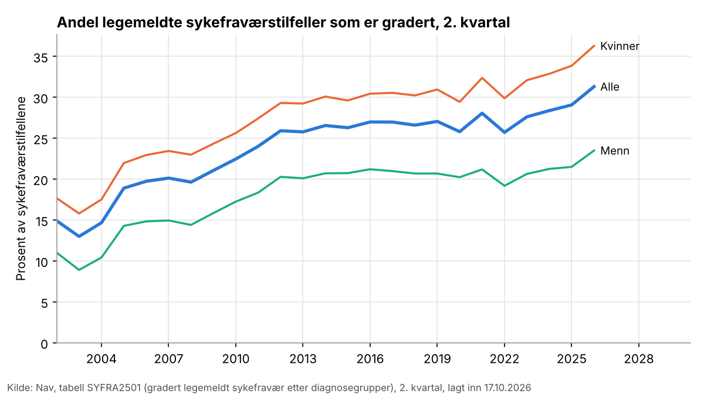
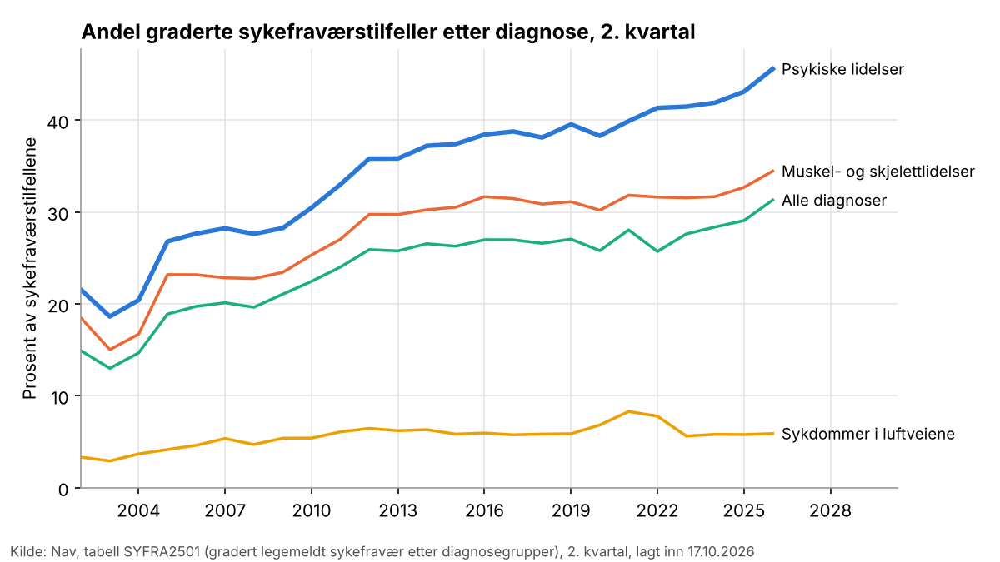

# Hva viser forskningen om gradert sykmelding og retur til arbeid?

Utkast, ukontrollert. Oppdatert 10.11.2026 med nye regler for vekting: hver studie er vurdert etter hvor troverdig den identifiserende antakelsen er, ikke bare etter metodenavnet, og elleve kilder fra to nye uavhengige utvalg er lagt til. Forrige versjon er fra 9.11.2026. Kildene er valgt etter skrevne kriterier, med søk, sporing av referanser og et uavhengig utvalg som er sammenlignet med det første. Tallene er hentet ut to ganger uavhengig og kontrollert mot sitat og side i kildene, og teksten er kontrollert mot forfatternes eget budskap. Svaret bygger på femtifire kilder lest i fulltekst og seksten kilder der bare sammendraget eller tittelen var tilgjengelig. Alle tall står med kilde og sitat i estimattabellen, og alle kildene står i [vedlegg A](vedlegg-kilder.md).

*Reproduserbarhet:* søk 9.11.2026, flettet med søk 10.11.2026; katalogene som de var 10.11.2026; første uttrekk, blind lesing og vurdering av troverdighet med samme modell som tråden (Opus), andre uttrekk med Sonnet; 16 av 70 kilder bare lest i sammendrag eller tittel. Den endelige vektingen er en vurdering og bør leses av en fagperson.

## Kort svar

Forskningen peker mot at gradert sykmelding kan gi noe raskere retur til arbeid når graderingen kommer etter noen uker, men belegget er tynt, og hvor stor effekten er, er usikkert. Studiene med mest troverdig identifikasjon finner raskere retur: en norsk studie som bruker at leger er ulikt tilbøyelige til å gradere, en nederlandsk studie som bruker forskjeller mellom saksbehandlere, og et lite finsk randomisert forsøk ved muskel- og skjelettlidelser. De to første gjelder lengre fravær, der graderingen kommer inn i løpet av de første månedene, og den nederlandske finner ingen sikker forskjell etter to år. To norske forsøk der fastlegene ble påvirket til å gradere oftere, fant ingen effekt på varigheten, men de tester økt bruk, ikke selve graderingen. Nedgangen i fraværet etter sykmeldingsreformen i 2004 knyttes mer til kravet om dokumentasjon etter åtte uker enn til graderingen. De store norske registeranalysene som finner små eller ingen effekter (Lie 2014 og Navs analyse av kommunene), veier mindre, fordi de bare justerer for målte kjennetegn eller mangler variasjon utenfra. Det samme gjelder de finske og tyske registerstudiene, som stort sett finner positive sammenhenger, og de svenske, som har blandede funn. Når graderingen bør starte, er uklart. Registerstudiene finner langsommere retur med gradering helt fra starten, men det kan skyldes at de som graderes tidlig, har dårligere prognose. Det finske forsøket startet graderingen tidlig og fant raskere retur, og den nederlandske studien fant at tidlig start virket bedre, unntatt ved psykiske lidelser. Svakere studier finner at overgangen til full uførepensjon blir mindre, men at noe av den flyttes til gradert uførepensjon. Ved psykiske lidelser spriker funnene mest. Få studier har målt helse, og de som har det, finner ingen forverring. FHIs kartleggingsoversikt fra 2018 konkluderer med at sikre konklusjoner om effekt ikke kan trekkes, men den bygger nesten bare på observasjonsstudier.

**Endret fra forrige versjon (9.11.2026).** Forrige versjon sa at forskningen ikke gir et entydig svar, og la om lag like stor vekt på de store norske registeranalysene som på studiene med sterkest design. Etter at troverdigheten i identifikasjonen er vurdert for hver studie, står Lie 2014 og Navs kommuneanalyse i kategori 5: de har verken variasjon utenfra eller noen måte å utelukke at de som blir gradert, er ulike på måter som ikke er målt. Konklusjonen er derfor flyttet mot de sterkere studiene. Den er fortsatt forsiktig, fordi bare legestudien har høy troverdighet, og fordi de randomiserte forsøkene er små eller tester noe annet enn selve graderingen.

## Bruken av gradert sykmelding i Norge

Statistikken under beskriver hvor vanlig gradering er. Den sier ingenting om effekten.

I 2. kvartal 2002 var 14,9 prosent av de legemeldte sykefraværstilfellene gradert. I 2. kvartal 2019 var andelen 27,1 prosent, og i 2. kvartal 2026 31,3 prosent. Andelen er høyere for kvinner (36,3 prosent) enn for menn (23,5 prosent) i 2. kvartal 2026. Tilfeller med psykiske lidelser er oftest gradert (45,6 prosent), mot 34,5 prosent ved muskel- og skjelettlidelser og 5,9 prosent ved sykdommer i luftveiene. Kilde: Nav, tabell SYFRA2501 (gradert legemeldt sykefravær etter diagnosegrupper), lagt inn 17.10.2026. Andelen er antall tilfeller med gradering i kvartalet som andel av alle legemeldte tilfeller i kvartalet. Nav fikk nytt mottak for sykmeldinger fra 1. kvartal 2022, så tall før og etter er ikke helt sammenlignbare.

Andre mål gir andre nivåer. Navs analyser av hele sykefraværstilfeller fant at 15 prosent av tilfellene som startet i 2009, ble gradert minst én gang, men 57 prosent av tilfellene som varte over 90 dager ([Brage, Kann og Nossen 2013](https://kudos.dfo.no/dokument/a0d29b59-a943-4e06-bb77-35d70df04c85)). Målt som andel av sykepengetilfellene som varer lenger enn arbeidsgiverperioden, var halvparten gradert i 2016 ([Nossen og Lysø 2018](https://www.nav.no/no/nav-og-samfunn/kunnskap/analyser-fra-nav/arbeid-og-velferd/arbeid-og-velferd/gradert-sykmelding-okt-gradering-stabil-varighet)). Tallene måler ulike ting og kan ikke sammenlignes direkte.

## Randomiserte forsøk

- **Finland, muskel- og skjelettlidelser:** Gradert sykmelding fra start, med tilrettelegging av arbeidet, ga raskere varig retur til arbeid (HR 1,76, KI 1,21–2,56, justert for søvnplager og tidligere fravær; HR 1,60, KI 0,98–2,63, justert bare for alder). Samlet fravær over 12 måneder var om lag 20 prosent lavere. Studien har bare 63 deltakere, nesten alle kvinner. ([Viikari-Juntura mfl. 2012](https://openalex.org/W2048984013)) Sluttrapporten fra prosjektet oppgir median 12 mot 20 dager til retur til vanlige arbeidsoppgaver, og at forskjellen ikke var signifikant uten justering (HR 1,52, KI 0,91–2,55). ([Viikari-Juntura mfl. 2011](https://www.finna.fi/Record/jykdok.2341206)) Samme forsøk fant ingen forverring i smerte, funksjon eller depresjon. ([Shiri mfl. 2013](https://openalex.org/W2013503454))
- **Norge, kurs i funksjonsvurdering for fastleger:** I et klyngerandomisert forsøk med 57 fastleger graderte legene som lærte strukturert funksjonsvurdering, oftere enn kontrollgruppen, og flere pasienter kom tilbake i deltidsarbeid. Det var ingen effekt på varigheten av sykefraværet. Forsøket tester økt bruk av gradering, ikke graderingen i seg selv. ([Østerås mfl. 2010](https://openalex.org/W2005271733), bare sammendrag)
- **Norge, aktiv sykmelding:** Et klyngerandomisert forsøk som fremmet aktiv sykmelding ved korsryggsmerter, ga ingen forskjell i fraværet (median 70, 68 og 71 dager). Forsøket testet tiltak for å øke bruken, ikke selve graderingen. ([Scheel mfl. 2002](https://openalex.org/W2073048698), bare sammendrag)
- **Danmark, aktiveringspakke:** En randomisert pakke med flere obligatoriske tiltak for sykmeldte ga samlet litt færre uker i ordinært arbeid, men forskjellen var ikke sikker etter tre år. Forfatterne skiller ut gradert tilbakeføring ved å bruke at jobbsentrene prioriterte den ulikt, så denne delen bygger på lokal praksis, ikke på loddtrekningen. Der ga gradert tilbakeføring 3,5 færre uker sykmeldt det første året, og om lag 30 flere uker i ordinært arbeid for dem som deltok, med stor usikkerhet (standardfeil 11,980). Effekten gjaldt dem som var sykmeldt fra ordinært arbeid og ikke hadde psykiske lidelser. Kilden er et arbeidsnotat fra IZA. ([Rehwald, Rosholm og Rouland 2016](https://openalex.org/W2796572035)) En artikkel fra samme forsøk kommer til samme konklusjon om gradering, og sier også at sammenligningen bygger på lokale strategier, ikke på loddtrekning. ([Rosholm mfl.](https://openalex.org/W4239637744), bare sammendrag)

## Instrumenter, reformer og naturlige eksperimenter (kategori 3)

- **Norge, forskjeller mellom leger:** Studien bruker at leger er ulikt tilbøyelige til å gradere, som et instrument. Effekten gjelder pasientene som legens praksis avgjør for, og forfatterne antar at de er relativt friske. Gradert sykmelding før 12. uke reduserte fraværet med minst 70 fulltidsdager og økte sysselsettingen to år senere med 12–14 prosentpoeng. Instrumentet er sterkt og er testet på flere måter, blant annet mot utfall før sykmeldingen, så dette er studien med mest troverdig identifikasjon. Kilden er et arbeidsnotat fra IZA. ([Markussen, Mykletun og Røed 2010](https://openalex.org/W2116716741))
- **Nederland, forskjeller mellom saksbehandlere:** Når gradert tilbakeføring startet det første halvåret, økte andelen tilbake i arbeid innen ett år med 38 prosentpoeng, og antall uker i arbeid over to år med 18. Når alle forløp som startet innen ett år regnes med, var effektene mindre og ikke signifikante (12,7 prosentpoeng). Etter to år var det ingen sikker forskjell (7,5 prosentpoeng). Hver uke senere start reduserte sannsynligheten for retur innen ett år med 4,4 prosentpoeng, men ved psykiske lidelser var tidlig start dårligere: én uke tidligere start ga 3 prosentpoeng lavere sannsynlighet for retur innen to år. ([Kools og Koning 2019](https://openalex.org/W2805335844))
- **Norge, sykmeldingsreformen 2004:** Reformen gjorde gradert sykmelding til utgangspunktet og krevde begrunnelse fra legen etter 8 uker uten arbeidsrelatert aktivitet. Sykefraværet falt med 18,8 prosent, og gradert sykefravær økte med 21 prosent. Forfatteren knytter mesteparten av nedgangen til kravet om dokumentasjon, ikke til graderingen. Studien sammenligner før og etter, uten kontrollgruppe. ([Markussen 2009](https://openalex.org/W1501193741)) Navs evaluering av samme reform fant ingen sammenheng mellom at legene graderte mer og senere avgang fra arbeidslivet. ([Kann og Brage 2007](https://www.nav.no/no/nav-og-samfunn/kunnskap/analyser-fra-nav/arbeid-og-velferd/arbeid-og-velferd/rask-friskmelding-oker-sjansen-for-a-forbli-i-arbeidslivet))

## Registerstudier med justering eller matching (kategori 4–5)

Studiene i dette og neste avsnitt sammenligner dem som ble gradert, med dem som ikke ble det. De kan ikke utelukke at gruppene er ulike på måter som ikke er målt, for eksempel helse og arbeidsevne. De veier derfor mindre enn studiene over, uansett hvor store de er.

- **Norge, Lie 2014:** Rapporten følger 283 296 personer gjennom gjentatte sykmeldinger og sammenligner graderte og fullt sykmeldte på samme tidspunkt i forløpet. Den justerer for hvem som blir gradert ved hjelp av vekter som endres over tid (inverse sannsynlighetsvekter), altså for observerbare kjennetegn. Forfatteren kaller analysen kausal, men den kan ikke utelukke forskjeller som ikke er målt. Vurdert som kategori 5 med lav troverdighet, fordi helse og arbeidsevne ikke er målt. Hovedbudskapet er at det har liten eller ingen effekt på varigheten å la fullt sykmeldte gå over til gradert sykmelding. Tidlig i forløpet går overgangen til jobb langsommere med gradering: for dem som starter med gradert sykmelding, er hasardraten 0,37 i den justerte modellen og 0,27 uten justering. Etter om lag 12 uker er det en liten positiv effekt, men bare i første sykepengetilfelle. Fullt sykmeldte blir oftere sykmeldt igjen etter at de har returnert. For andre utfall enn retur til arbeid er resultatene sprikende. Dette er den norske studien FHI-oversikten fra 2018 omtaler som et unntak. ([Lie 2014](https://kudos.dfo.no/dokument/7799f411-4c20-4a1a-aa6f-5aa52fbc9eab)) En beskrivende forløpsanalyse av det samme materialet fra 2010 viste at overgangen til jobb var dobbelt så rask fra full som fra gradert sykmelding (hasardrate 2,0), og at de som startet gradert, var 37 færre dager i jobb over to år. Forfatteren understreker at resultatene ikke kan tolkes som effekter. ([Lie 2010](https://kudos.dfo.no/dokument/b027fe4b-4bf4-433e-b689-b7d06086b095))
- **Finland, etter at delvise sykepenger ble innført i 2007:** Studiene sammenligner dem som valgte delvise sykepenger, med fullt sykmeldte som kunne fått dem, og bruker matching og endring før og etter. Forfatterne kaller det et kvasieksperiment, men kontrasten er hvem som valgte gradering, ikke lovendringen i seg selv, så gruppene kan være ulike på måter som ikke er målt. Studiene er derfor vurdert som kategori 5. Arbeidsdeltakelsen falt mindre blant dem som var sykmeldt i minst 60 dager og fikk gradering: 5,3 prosentpoeng (KI 3,1–7,5) i hele utvalget og 9,8 prosentpoeng (KI 5,9–13,7) i et matchet utvalg. Forskjellen var størst ved psykiske lidelser (12,8 prosentpoeng, og 18,9 i det matchede utvalget) og mindre ved muskel- og skjelettlidelser (6,3 prosentpoeng). ([Kausto mfl. 2014](https://openalex.org/W2132658439)) En senere studie av samme ordning, med matchede grupper, fant 8,0 prosentpoeng høyere andel med varig retur (KI 5,3–10,9) og 10,5 prosent mer tid i arbeid over to år. Risikoen for full uførepensjon innen to år var 4,5 prosentpoeng lavere (KI 3,1–5,6), men gradert uførepensjon ble vanligere. ([Viikari-Juntura mfl. 2017](https://openalex.org/W2744665053)) En oppfølgingsstudie av samme materiale fant lavere trygdekostnader, om lag 2395 euro per person per år. ([Viikari-Juntura mfl. 2019](https://openalex.org/W2896121459))
- **Finland, yrkesaktiv tid:** Å gå over til gradert sykmelding etter en periode med full, sammenlignet med å fortsette på full, var forbundet med lengre forventet yrkesaktiv tid fra 30 år, 2,63 år for menn og 1,98 år for kvinner, og mest ved psykiske lidelser (3,92 år) og minst ved muskel- og skjelettlidelser (1,02 år). Tallene er framskrevet fra en kortere oppfølging. ([Hartikainen mfl. 2022](https://openalex.org/W4293168340)) En doktoravhandling som bygger på det samme materialet, fant 2,86 år mer i privat sektor (KI 1,52–4,22) og 1,03 år mer i offentlig sektor (KI 0,28–1,78). ([Hartikainen 2025](https://www.finna.fi/Record/fikka.5922382))
- **Finland, uføretrygd:** Gradert sykmelding var forbundet med 6 prosentpoeng lavere risiko for full uførepensjon og 8 prosentpoeng høyere risiko for gradert uførepensjon. ([Kausto mfl. 2012](https://openalex.org/W2159632075))
- **Tyskland, etter rehabilitering:** Gradert tilbakeføring var forbundet med lavere risiko for uførepensjon (HR 0,62, KI 0,49–0,80), 12 920 euro mer i arbeidsinntekt over tre år og 52 færre dager med sykepenger. ([Bethge 2016](https://openalex.org/W2341011605)) En matchet studie med 1 009 par fant høyere andel i arbeid, færre uførepensjoner og mindre fravær etter 15 måneder, mest for dem med høy risiko for uførhet eller mer enn tre måneders fravær før rehabiliteringen. ([Bürger og Streibelt 2018](https://openalex.org/W2810202913), bare sammendrag) Ved psykiske lidelser var 88 mot 73 prosent i full jobb etter 15 måneder (RR 1,22, KI 1,13–1,31), men under halvparten svarte, og utfallene er selvrapportert. ([Streibelt mfl. 2017](https://openalex.org/W2605726377))
- **Canada, yrkesskader:** I en matchet kohort med muskel- og skjelettskader hadde de med gradvis tilbakeføring om lag 24 flere fraværsdager før varig retur når fraværet var kort (24,6 dager ved medianen, KI 19,9–29,2), men færre når fraværet var langt (−9,4 dager ved 70. persentil, KI −22,2–3,5, ikke signifikant). ([Maas mfl. 2021](https://openalex.org/W3138116577))

## Andre registerstudier

- **Norge, forskjeller mellom kommuner:** Navs analyse følger kommunene over tid og sammenligner dem med seg selv. Når andelen graderte fraværsdager økte med ett prosentpoeng, falt sykefraværsraten med 1,79 prosent før reformen i 2004 og med 2,37 prosent i en dynamisk modell etter reformen. Varigheten gikk ned med 0,49 prosent og andelen sykmeldte med 1,34 prosent. Forfatterne kaller effektene små. Variasjonen mellom kommunene kommer ikke utenfra, og studien kan ikke utelukke at andre forhold i kommunene ligger bak. ([Brage, Kann og Nossen 2013](https://kudos.dfo.no/dokument/a0d29b59-a943-4e06-bb77-35d70df04c85); samme materiale som [Kann mfl. 2012](https://www.nav.no/no/nav-og-samfunn/kunnskap/analyser-fra-nav/arbeid-og-velferd/arbeid-og-velferd/har-gradert-sykmelding-effekt-pa-sykefravaeret))
- **Norge, nakke og rygg:** Pasientene med gradert sykmelding returnerte oftere til arbeid etter 12 måneder (RR 1,29 ujustert). Når forskerne justerte for at disse pasientene hadde mindre symptomer, gikk effekten ned til RR 1,19 (KI 1,12–1,26). ([Bardal mfl. 2025](https://openalex.org/W4408975540))
- **Sverige:** Resultatene avhenger av hvordan gradert sykmelding defineres og hvem effekten gjelder. I én studie av muskel- og skjelettlidelser var sannsynligheten for å få tilbake full arbeidsevne 25 prosentpoeng høyere som gjennomsnitt for alle sykmeldte, men effekten for dem som faktisk ble gradert, var ikke signifikant. ([Andrén og Svensson 2009](https://openalex.org/W2079898261), arbeidsnotat) En annen studie fant at effekten for dem som faktisk ble gradert, var positiv med alle fire definisjoner av gradering (0,342 med den laveste). Gjennomsnittseffekten for alle sykmeldte var om lag 15 prosentpoeng med én definisjon, men ikke signifikant med definisjonen forfatteren foretrekker (0,063). Studien bruker yrke som instrument, som forfatteren selv drøfter svakheter ved. ([Andrén 2011](https://openalex.org/W3122932312), arbeidsnotat) To andre svenske studier med samme type instrument finner at det å starte sykmeldingen gradert gir lavere sannsynlighet for full arbeidsevne den første måneden (−0,3924 for dem som ble gradert), men høyere fra om lag fem måneder (+0,0791 til +0,1307). ([Andrén og Andrén 2009](https://openalex.org/W1579837130), arbeidsnotat; [Andrén og Andrén 2008](https://openalex.org/W2025121479), bare sammendrag) De svenske studiene bygger på det samme materialet og er ikke uavhengige funn. For arbeidsledige var effekten for dem som ble gradert, negativ og ikke signifikant (−0,130, bare 52 gradert), og for arbeidstakere snudde fortegnet med en annen modell. ([Andrén 2011, arbeidsledige](https://openalex.org/W1527098577), arbeidsnotat) Yrke er et svakt instrument, fordi det henger sammen med hvilken sykdom man har og hvor alvorlig den er. De svenske studiene står derfor i kategori 4.
- **Psykiske lidelser, Sverige og Danmark:** I en svensk studie hadde gradering nesten ingen effekt i hele utvalget (0,015), men stor effekt (0,387) for dem som hadde vært fullt sykmeldt i 60 dager. ([Andrén 2010](https://openalex.org/W1511717146), arbeidsnotat) En dansk studie fant ingen effekt for psykiske lidelser, men en effekt for andre lidelser når den kontrollerte for uobserverte forskjeller. ([Høgelund mfl. 2012](https://openalex.org/W88826225), bare sammendrag)
- **Svakere design med blandede funn:** I en nederlandsk studie var sykefraværet 1,40 ganger lengre med gradert sykmelding før justering. Når tidspunktet ble tatt med, var det stort sett ingen forskjell, men for dem som startet gradering etter 90–180 dager, var fraværet 0,75 ganger så langt. ([Bosman mfl. 2019](https://openalex.org/W2982381358)) En masteroppgave fra Troms fant lengre sykmeldinger målt i kalendertid, men kortere effektivt fravær når graderingen ble regnet med, for fravær over åtte uker. Oppgaven hadde ikke data om diagnose. ([Kristoffersen 2019](https://openalex.org/W2986214152))
- **Norske beskrivende analyser:** Hvor lenge graderte fravær varer sammenlignet med ikke-graderte, avhenger av definisjonen: fra 92 dager lengre når alle som noen gang ble gradert regnes med, til 21 dager kortere med forfatternes foretrukne definisjon. Forfatterne understreker at de ikke gjør en effektstudie. De mener også at utvalget i legestudien (dem som fortsatt er sykmeldt etter åtte uker) kan gi skjevhet i favør av gradering: med samme utvalg fant de 23 dager kortere fravær for de graderte, uten noen kontroll for hvem som blir gradert. ([Nossen og Brage 2013](https://www.nav.no/no/nav-og-samfunn/kunnskap/analyser-fra-nav/arbeid-og-velferd/arbeid-og-velferd/effekt-av-gradert-sykmelding-betydningen-av-metodevalg)) En forløpsanalyse av alle sykepengetilfeller 2003–2014 fant at de som startet med full sykmelding, ble raskere friskmeldt enn de som startet gradert: sannsynligheten for friskmelding var om lag 24 prosent lavere med gradert start (hasardrate 0,761 med kontroll for alder, diagnose og tidligere fravær). Forskjellen snudde etter om lag 30 uker, tidligere ved lav gradering og senere ved høy. Forfatterne kan ikke skille mellom at de som blir gradert har dårligere prognose, og at graderingen holder folk lenger i sykmelding. ([Nossen og Brage 2016](https://www.nav.no/no/nav-og-samfunn/kunnskap/analyser-fra-nav/arbeid-og-velferd/arbeid-og-velferd/forlopsanalyse-av-sykefravaer-nar-blir-folk-friskmeldt)) Andelen sykepengetilfeller med gradering økte, mens varigheten lå stabilt på om lag 60 sykepengedager. ([Nossen og Lysø 2018](https://www.nav.no/no/nav-og-samfunn/kunnskap/analyser-fra-nav/arbeid-og-velferd/arbeid-og-velferd/gradert-sykmelding-okt-gradering-stabil-varighet)) Blant dem som brukte opp sykepengene i 2011, hadde 72 prosent av dem med 50 prosent gradering og 38 prosent av de fullt sykmeldte et arbeidsforhold om lag to og et halvt år senere. Flere av de graderte fikk uførepensjon (19 mot 13 prosent), mest gradert. Forfatterne kan ikke si om graderingen er årsaken. ([Grødem, Orupabo og West Pedersen 2015](https://nva.sikt.no/registration/0198cc8d6f08-8af27b58-5e7a-47d1-8504-4bc4b0361a42))
- **Helse:** I norske registerdata hadde de på full sykmelding størst bedring i smerterelatert funksjon over seks måneder, men de lå fortsatt høyest. Gruppene var ulike fra start. ([Sanatkar mfl. 2025](https://openalex.org/W4410013226))

## Oversikter

- **FHIs kartleggingsoversikt fra 2018** fant ett lite randomisert forsøk og tolv registerstudier fra Norden og Tyskland. Forsøket og åtte av ni registerstudier som målte retur til arbeid, gikk i favør av gradert sykmelding. Unntaket var Lie 2014 (HR 0,37, KI 0,36–0,38). Forfatterne skriver at gradert sykmelding kan henge sammen med kortere fravær og høyere arbeidsdeltakelse, men at sikre konklusjoner om effekt ikke kan trekkes, fordi nesten alt bygger på observasjonsdata. Oversikten vurderes derfor etter studiene den bygger på (kategori 4). ([Meneses mfl. 2018](https://openalex.org/W2911999154))
- **Et norsk forskermøte i 2013** om tiltakene i IA-avtalen konkluderte med at økt bruk av gradert sykmelding er det tiltaket som har best dokumentasjon for å redusere sykefraværet. Møtet hadde ikke systematisk søk, og forfatterne av hovedstudiene deltok selv. Konklusjonen bygger særlig på studien som bruker forskjeller mellom leger (Markussen mfl., omtalt over) og en dansk studie. ([Effekter av tiltak under IA-avtalen 2013](https://kudos.dfo.no/dokument/34183300-cbad-41d5-8e50-9684f7850798)) Rapporten ble skrevet før Lie 2014 kom.
- **Nordiske oversikter:** Den nordiske oversikten fra 2008 fant seks prospektive studier, ingen randomiserte, og konkluderte med at kunnskapsgrunnlaget var svakt og funnene motstridende. ([Kausto mfl. 2008](https://openalex.org/W2325466037)) Den nordiske kunnskapsoppsummeringen fra 2010 bygger for gradert sykmelding på den samme oversikten og kommer til samme konklusjon. ([Ellingsen mfl. 2010](https://openalex.org/W3010213937)) En norsk masteroppgave med systematisk oversikt fant 13 skandinaviske studier av gradert eller aktiv sykmelding og ingen klar sammenheng med kortere fravær; resultatene spriket. Oversikten er beskrivende og gir ikke et samlet anslag. ([Gjerde 2010](https://nva.sikt.no/registration/019904aa7986-0e4c2361-eb33-4871-9ab3-47b965597085)) En finsk oversikt over tjueni publikasjoner fra 2008–2019 finner at delvis sykmelding er positivt forbundet med retur til arbeid ved både muskel- og skjelettlidelser og psykiske lidelser. ([Reini 2020](https://openalex.org/W3023766513), bare sammendrag) En finsk avhandling fant fem metodisk sterke nordiske studier, og fire av dem viste bedre retur eller sysselsetting med gradert sykmelding. ([Kausto 2014](https://openalex.org/W1592746682), bare sammendrag)
- **Europeiske oversikter:** En oversikt over tiltak for retur til arbeid ved kroniske sykdommer fant at de fire nordiske studiene om gradering alle tyder på bedre arbeidsdeltakelse, men gir ikke et samlet anslag. ([Sabariego mfl. 2018](https://openalex.org/W2794297004)) En oversikt over arbeidsgiverrettede tiltak for personer med funksjonsnedsettelse fant at gradert sykmelding og gradert tilbakeføring er blant tiltakene med mest konsistent positiv sammenheng, men at belegget er usikkert ved psykiske lidelser. ([Derbyshire mfl. 2024](https://openalex.org/W4392582001)) Begge bygger mest på de samme nordiske registerstudiene som er omtalt over, og er ikke uavhengige funn. En japansk oversikt for retningslinjer fant at kortere arbeidstid eller lettere arbeid ved retur kan redusere nye sykmeldinger ved muskel- og skjelettlidelser, med lavt belegg. ([Nogawa og Kojimahara 2018](https://openalex.org/W2794825180))
- **Andre oversikter:** En oversikt over svært tidlige arbeidsplasstiltak fant ingen samlet effekt av tre randomiserte forsøk (HR 1,3, KI 0,9–1,9); det finske forsøket var det eneste med tydelig effekt. ([Vargas-Prada mfl. 2016](https://openalex.org/W2412604146)) Et norsk forskningskart fra 2021 fant seks studier om gradert sykmelding, men sammenfatter ikke resultatene. ([Berg mfl. 2021](https://openalex.org/W3198402854)) En kartlegging av 35 skandinaviske artikler finner sprikende funn og legger vekt på at effekten for dem som blir gradert, ikke er det samme som effekten av å gradere flere. ([Grønstad 2024](https://openalex.org/W4404867325)) En dansk oversikt fant positive, men forholdsvis små effekter av arbeidsplasstiltak, også delvis sykmelding. ([Høgelund 2014](https://openalex.org/W2746656768), bare sammendrag)

## Hvorfor studiene spriker

- **Tidspunkt:** Funnene motsier hverandre mindre enn det kan se ut. Legestudien gjelder gradering før 12. uke for dem som fortsatt er sykmeldt etter 8 uker, og saksbehandlerstudien gradering i løpet av det første halvåret. Lie 2014 finner langsommere retur først og fremst for dem som er gradert helt fra starten, og en liten gevinst etter om lag 12 uker. Studiene sammenligner også ulike grupper: legestudien gjelder pasienter der legens praksis avgjør valget, mens Lie sammenligner alle som er gradert på et gitt tidspunkt med alle som er fullt sykmeldt på samme tidspunkt.
- **Definisjon:** Navs egne analyser viser at varigheten kan se lengre eller kortere ut avhengig av om alle som noen gang ble gradert, regnes med, og svenske studier får ulike svar med ulike definisjoner.
- **Utfall:** Gradering gir mer arbeid mens fraværet varer, men kan gjøre selve fraværet lengre målt i kalendertid. Uføre flyttes delvis fra full til gradert uførepensjon.
- **Seleksjon:** De som blir gradert, er ofte friskere eller har bedre prognose. Studier som bare justerer for målte kjennetegn, kan overvurdere effekten. Lie 2014 tolker den negative effekten tidlig i forløpet som at gradering helt i starten i seg selv kan være et tegn på dårlig prognose.

## Beslektede tiltak

- **Aktivitetskravet:** Strengere håndheving av kravet om å være delvis i arbeid etter 8 uker i Hedmark ga 12 prosent lavere sykefravær enn i en syntetisk kontrollregion, men studien måler håndhevingen, ikke graderingen i seg selv. ([Hernæs 2017](https://openalex.org/W3121578847), arbeidsnotat) Aktivitetskravet og Hedmarksmodellen er behandlet i et eget svar.
- **Bedriftene:** I norske bedrifter hang ett prosentpoeng mer fullt sykefravær sammen med 1,7 prosent lavere avkastning på eiendelene, og den negative sammenhengen var 70 prosent mindre når fraværet var gradert. ([Godøy 2016](https://openalex.org/W2473929489))
- **Finland, tilrettelagte oppgaver:** En ordning med alternative arbeidsoppgaver i stedet for sykmelding ga noe mindre økning i fraværsdagene enn i byer uten ordningen (RR 1,14 mot 1,19). Bare 1–4 prosent brukte ordningen. ([Mattila-Holappa mfl. 2021](https://openalex.org/W3170959179))
- **Storbritannia, «fit note»:** Muligheten for å skrive at den sykmeldte kan arbeide med tilrettelegging ble brukt i 6,5 prosent av sykmeldingene fra fastleger, og det er ikke vist at ordningen har redusert sykefraværet. ([Dorrington mfl. 2018](https://openalex.org/W2799283105), bare sammendrag)

## Forbehold

- Bare ett lite randomisert forsøk tester selve graderingen. Resten er kvasieksperimenter og registerstudier der lege, saksbehandler eller arbeidsgiver velger hvem som blir gradert.
- Troverdigheten i identifikasjonen er vurdert av en språkmodell ut fra metodedelen i hver studie, og ikke kontrollert av en fagperson. Den avgjør mye av vektingen i det korte svaret.
- De norske studiene med størst materiale (Lie 2014, Navs kommuneanalyse) og studien med sterkest design (legestudien) gir ulike svar. Svaret legger mest vekt på legestudien. Navs metodeartikkel fra 2013 mener at utvalget i den studien kan gi skjevhet i favør av gradering (se «Andre registerstudier»). Instrumentet er testet, men innvendingen er ikke prøvd i en egen studie. Ingen norsk studie med sterkt design er nyere enn 2014, bortsett fra studier av helse og av aktivitetskravet.
- Flere studier bygger på samme materiale, særlig de finske og Navs analyser, og bør ikke telles som uavhengige funn.
- Sentrale kilder som ikke kunne leses i fulltekst: den publiserte versjonen av Hernæs 2018 (arbeidsnotatet er lest), Høgelund mfl. 2009, Schneider mfl. 2015, Andrén 2013 og Andrén mfl. 2016, Kausto 2014 (bare sammendrag), Østerås mfl. 2010 og Bürger og Streibelt 2018 (bare sammendrag), Schneider mfl. 2016 og Andrén og Andrén 2025 (bare tittel), en rapport om aktiv sykmelding fra 2004, Kelas evaluering av delvise sykepenger fra 2009 to finske oversikter (2020 og 2022) Reini 2020 er bare lest i sammendrag.
- Danske rapporter på eget språk og de nyeste arbeidsnotatene kan mangle, fordi søket ikke dekker dem godt. Det engelske søket er ikke kjørt på nytt, så danske uttrykk er ikke søkt i den internasjonale databasen. Det svenske søket fant ingen effektstudier.
- To nye uavhengige kildeutvalg 10.11.2026 fant elleve sterke kilder som manglet, blant dem tre oversikter og et norsk randomisert forsøk. Hvert av dem fikk med om lag tre av fire sterke kilder i det første utvalget. Utvalget er derfor trolig ikke fullt mettet.
- Tallene er hentet automatisk og er ikke kontrollert av en fagperson.

## Kunnskapshull og mulige egne analyser

- **Ingen nyere norsk effektstudie.** De norske effektanalysene bruker data fra før 2014, og gradering er blitt langt vanligere siden. Det finnes ingen norsk studie som tester graderingen med loddtrekning.
- **Hvorfor de norske studiene spriker.** En analyse som bruker samme data med både legenes graderingspraksis som instrument og sammenligning på samme tidspunkt i forløpet, kunne vise om forskjellen skyldes metode eller hvem som sammenlignes.
- **Mulig egen analyse i microdata.no (utkast):** Sykepengedata med graderingsgrad og tidspunkt, koblet til a-ordningen og uføretrygd, kunne gi oppdaterte beskrivende tall for retur til arbeid og overgang til uføretrygd etter gradert og full start, etter diagnose og tidspunkt. Variablene må finnes i variabelkatalogen på microdata.no. En enkel sammenligning av graderte og fullt sykmeldte viser ikke effekt, fordi de som blir gradert, er ulike fra start.

## Vedlegg

- [Vedlegg A: kildeoversikt med alle tall](vedlegg-kilder.md)
- Sentrale kilder som ikke er lest eller er utelatt, med begrunnelse: `utelatt.tsv` og `mangler.md`
- Metode: `kriterier.md`, `utvalg.md`, `metning.md` og `sammenligning.md`
