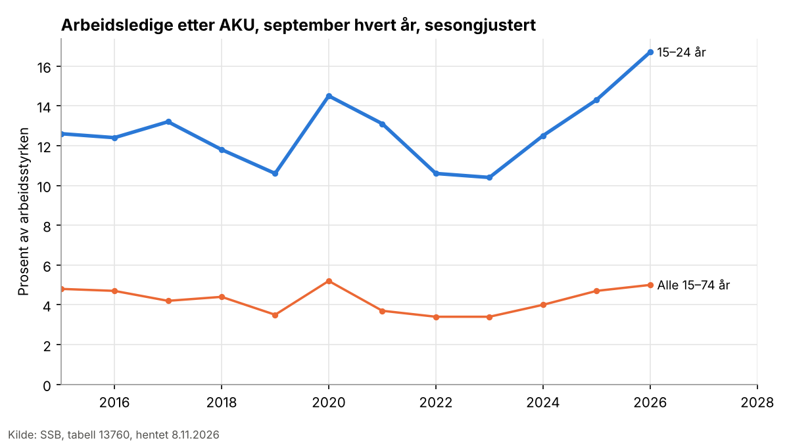
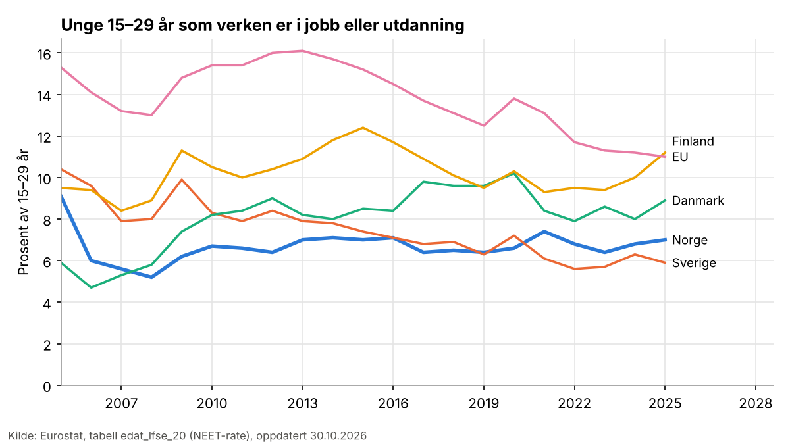
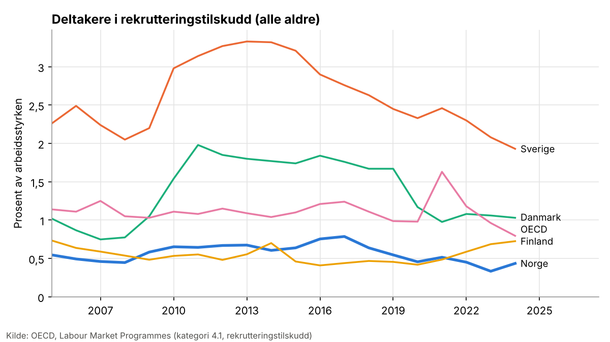

# Lønnstilskudd for unge: hva viser forskningen?

**Status: utkast, ukontrollert.** Laget 8.11.2026 i en kaldtest av løypa, kjørt på nytt 9.11.2026 med nye norske kilder fra DFØs Kudos-katalog og Navs bibliotek, og utvidet 11.11.2026 med rapporter bestilleren lastet opp og åpne versjoner funnet med nettsøk. Tallene er hentet ut av Claude og kontrollert mot sitat og side, men ikke av en fagperson.

*Reproduserbarhet:* søk 8.11.2026, med norske kataloger 9.11.2026 og nettsøk etter åpne versjoner 11.11.2026; katalogene som de var 11.11.2026 (commit 49132f4); uttrekk med samme modell som tråden (Opus), blind lesing og blind innholdskontroll med Sonnet; ett blindt utvalg; én av sekstisju kilder i uttrekket bare lest i sammendrag. Den endelige vektingen er en vurdering og bør leses av en fagperson.

**Spørsmålet** (mandat godkjent av bestilleren 8.11.2026): Øker lønnstilskudd til arbeidsgivere sannsynligheten for at unge under 30 år uten jobb kommer i og blir i ordinært arbeid, sammenlignet med andre tiltak eller ingen tiltak?

**Kildegrunnlaget.** Utvalget har hundre og tretti oppføringer, mange av dem versjoner av samme studie. Åttiåtte har fulltekst. Svaret bygger på uttrekk fra sekstisju kilder: tjueto oversikter og metaanalyser, tjuetre norske eller nordiske studier og rapporter og tjueto studier fra andre land. Én av dem (forsøket i Jordan) er bare lest i sammendrag. Resten av utvalget er bare vurdert på tittel og sammendrag, blant dem flere sentrale (se «Forbehold»). Den tredje runden (11.11.2026) la til begge delrapportene fra områdegjennomgangen av arbeidsmarkedstiltak, evalueringen av varig lønnstilskudd, to norske registerstudier fra 2024 og 2025, Card, Kluve og Weber (2010) og elleve arbeidsnotater og rapporter som lå åpent hos forfatterne eller i arbeidsnotatserier.

## Kort svar

Lønnstilskudd øker sysselsettingen blant unge mens tilskuddet varer, men de best identifiserte studiene gir lite grunnlag for å si at unge under 30 år uten jobb får varig mer ordinært arbeid av det. Store positive effekter finnes mest i studier med matching, der deltakerne trolig er positivt utvalgt.

- **De sterkeste designene** (aldersgrenser og reformer i Belgia, Polen og Storbritannia, og et randomisert forsøk i Jordan) finner en tydelig gevinst på kort sikt, men liten eller ingen varig netto effekt etter at tilskuddet er slutt. I Belgia var mye av gevinsten i privat sektor erstatning for andre jobber. I Jordan var effekten 38 prosentpoeng mens kupongen gjaldt, og liten og ikke signifikant etterpå ([Groh mfl. 2016](https://openalex.org/W2306814610), bare lest i sammendrag).
- **Oversiktene** finner at tiltak virker svakere for unge enn for andre ([Card, Kluve og Weber 2010](https://openalex.org/W1805206376); [Kluve 2006](https://openalex.org/W2010586812)), og Campbell-oversikten finner ingen samlet effekt av subsidiert sysselsetting for unge i høyinntektsland ([Kluve mfl. 2017](https://openalex.org/W4233730326)). En nordisk metaanalyse finner oftere positive funn for lønnstilskudd (om lag 60 prosent) enn for opplæring (42 prosent), men den teller bare fortegn og signifikans, og de fleste studiene bygger på matching ([Hardoy mfl. 2017](https://nva.sikt.no/registration/0198cc97b527-72b1e897-3c8b-47e2-8c9a-dd6326e550b4)).
- **Sammenlignet med andre tiltak** kommer lønnstilskudd i privat sektor oftest bedre ut enn offentlige sysselsettingsprogrammer og arbeidspraksis. Forskjellen til opplæring er liten eller uklar og ser ut til å minke over tid.
- **I Norge** viser registerstudiene store effekter av midlertidig lønnstilskudd, men de gjelder alle aldre eller personer med nedsatt arbeidsevne, og forfatterne finner eller kan ikke utelukke positiv seleksjon. Den største gir ingen tydelige aldersforskjeller ([Oslo Economics og Frischsenteret 2024](https://bibliotek.nav.no/record/4986)). En forløpsstudie av personer med nedsatt arbeidsevne finner om lag 30 prosentpoeng flere i arbeid etter tre år, mest av sju tiltak ([Golombek mfl. 2025](https://nva.sikt.no/registration/01995c22c1ef-0cff9bef-2a70-4f0e-ab36-b6d53db8f287)). For unge med nedsatt arbeidsevne er de norske funnene sterkest. For ordinære unge arbeidssøkere spriker de eldre tallene mellom årskull.
- **Navs egne tall** viser at 41,4 prosent av deltakerne 18–24 år og 44,9 prosent av deltakerne 25–29 år får stabil jobb innen tre år etter start på midlertidig lønnstilskudd. Det er beskrivende tall, ikke effekter ([Nossen 2024](https://www.nav.no/no/nav-og-samfunn/kunnskap/analyser-fra-nav/arbeid-og-velferd/arbeid-og-velferd/arbeid-og-velferd-nr.3-2024/midlertidig-lonnstilskudd-i-hvilken-grad-oppnas-en-stabil-arbeidstilknytning)).
- **Dødvekten er stor**, og fortrengning er lite studert. Tilskuddet ser ut til å virke best når det er målrettet mot dem som står langt fra arbeid, og når arbeidsmarkedet ikke er stramt. Ingen norsk studie av unge bygger på et forsøk eller en regelendring.

## Statistikk

Statistikken beskriver nivå og utvikling og sier ingenting om effekt. Tallene er hentet i oktober og november 2026 og kan bli revidert.

**Deltakere i Norge (Nav, TILT110).** I januar–september 2026 var i gjennomsnitt 4854 personer per måned på midlertidig lønnstilskudd. Av dem var 1597 under 30 år (134 under 20 år, 685 i alderen 20–24 og 778 i alderen 25–29), om lag 33 prosent. På varig lønnstilskudd var det 3781 personer, av dem 90 i alderen 20–24 og 307 i alderen 25–29. I september 2026 var 6028 på midlertidig lønnstilskudd. I Navs arbeidsindikator økte antallet på midlertidig lønnstilskudd fra 4768 i juli 2023 til 7968 i juni 2025.

**Ledighet blant unge.** Registrert helt ledige hos Nav var 2,6 prosent av arbeidsstyrken for 20–24 år og 2,5 for 25–29 år i september 2026, mot 2 prosent for alle (Nav, HL050). Arbeidskraftundersøkelsen gir et høyere nivå fordi den teller også dem som ikke er registrert hos Nav: sesongjustert ledighet for 15–24 år var 16,7 prosent i september 2026, mot 12,6 i september 2015 og 5,0 for hele arbeidsstyrken (SSB, AKU, sesongjustert).

**Unge utenfor arbeid og utdanning (Eurostat, edat_lfse_20).** Andelen 15–29 år som verken er i jobb eller utdanning, var 7,0 prosent i Norge både i 2015 og 2025, mot 5,9 i Sverige, 8,9 i Danmark, 11,2 i Finland og 11,0 i EU i 2025. Eurostats definisjon er ikke den samme som Navs eller SSBs.

**Bruk av lønnstilskudd i Norden (OECD, LMP).** Norge brukte 0,05 prosent av BNP på rekrutteringstilskudd i 2024, ned fra 0,081 i 2015, mot 0,282 i Sverige, 0,065 i Danmark, 0,045 i Finland og 0,041 i OECD. Deltakerne utgjorde 0,435 prosent av arbeidsstyrken i Norge, mot 1,93 i Sverige, 1,03 i Danmark og 0,795 i OECD. OECDs kategori for rekrutteringstilskudd er tidsbegrensede tilskudd for å ansette; varig lønnstilskudd hører trolig til en annen kategori.

## Funn etter design

### Reformer og diskontinuiteter (sterkest design)

- **Sverige, nystartsjobber ([Sjögren og Vikström 2015](https://openalex.org/W2039276519)).** Dobling av tilskuddssatsen i 2009 økte overgangen til jobb med 12–19 prosent i tilskuddsperioden for voksne langtidsledige, uten effekt på senere jobb uten tilskudd. Lengre varighet ved aldersgrensen for eldre ga 5–7 prosentpoeng høyere sysselsetting etter at et kort tilskudd var utløpt. Ingen resultater for unge. Arbeidsnotatversjonen er lest, og den publiserte versjonen kan avvike.
- **Sverige, ungdomsgarantien ([Carling og Larsson 2004](https://openalex.org/W1521518092)).** Diskontinuitet ved 25 år. Garantien for 20–24-åringer (ikke lønnstilskudd) ga om lag 10 prosent raskere overgang til jobb tidlig i ledighetsperioden, men effekten var borte etter 120 dager og ble deretter utlignet av en negativ effekt.

- **Belgia, unge med lav utdanning ([Albanese, Cockx og Dejemeppe 2024](https://openalex.org/W4399204261)).** Et forsterket lønnstilskudd for unge under 26 år, sammenlignet med det vanlige og mindre tilskuddet for dem over 26, ga 10,5 prosentpoeng høyere overgang til privat jobb innen ett år (KI 3,0–18,1). Etter sju år hadde unge med fullført videregående 2,8 flere kvartaler i privat jobb (KI 0,7–5,0), men 2,6 færre i offentlig jobb og som selvstendige, så samlet sysselsetting økte ikke. For unge uten fullført videregående var det ingen varig effekt (0,2 kvartaler). Studien er lest i en åpen versjon (arbeidsnotat).
- **Belgia, stramt arbeidsmarked ([Dejemeppe mfl. 2025](https://openalex.org/W4412889165)).** Tidlig tilgang til tilskudd for unge under 25 år i perioden 2017–2019, sammenlignet med senere tilgang, hadde ingen signifikant effekt på overgang til jobb (0,5 prosentpoeng for unge uten videregående, −0,8 for unge med). Forfatterne regner at 97,8 prosent av mottakerne ville fått jobb uten tilskuddet. Overgangen via vikarbyrå gikk ned med 5,2 prosentpoeng, altså en forskyvning mellom ansettelsesformer.
- **Polen ([Kunze mfl. 2026](https://openalex.org/W7139965069)).** Unge kvinner som var berettiget til lønnstilskudd, hadde 2,8 prosentpoeng høyere sannsynlighet for å ha forlatt ledighetsregisteret etter 30–36 måneder, og 3,5 for kvinner med små barn. For unge menn fant studien ingen effekt på mellomlang sikt og en innlåsing på 3,5 prosentpoeng i andre år.
- **Storbritannia, New Deal for Young People ([Blundell mfl. 2004](https://openalex.org/W2150829746)).** Programmet, som kombinerte jobbsøkingsbistand og lønnstilskudd, ga unge menn 18–24 år om lag 5 prosentpoeng høyere overgang til jobb de første fire månedene. Minst 1 prosentpoeng skyldes jobbsøkingsbistanden. For unge kvinner var effekten 6,1 prosent, mest via lønnstilskuddet. Studien fant ikke tegn til store substitusjonseffekter.
- **Norge, ungdomsgarantien ([Hardoy mfl. 2006](https://nva.sikt.no/registration/0198cc42013c-11c98f48-47eb-4b66-ac7a-ba3c43edfc15)).** Forsterket tiltaksinnsats for langtidsledige 20–24 år på 1990-tallet økte overgangen fra ledighet til jobb med 10,65 prosent. Forfatterne kaller effektene svake, og studien skiller ikke ut lønnstilskudd.

### Registerstudier med matching eller forløpsmodeller

- **Norge, alle Navs tiltak 2017–2019 ([Oslo Economics og Frischsenteret 2024](https://bibliotek.nav.no/record/4986)).** Studien sammenligner personer som starter på et tiltak, med matchede personer i samme innsatsgruppe som ikke starter. Midlertidig lønnstilskudd ga om lag 5 måneder mer i arbeid og nesten 200 000 kroner mer i lønnsinntekt det første året, det klart største av tiltakene. Effekten omtrent halveres i andre år, men er fortsatt størst. Effekten i andre og tredje år var 1,22 måneder i arbeid per år for deltakere under 20 år og 1,50 måneder høyere for 20–29 år, mens 50–59 år hadde 2,62 måneder høyere effekt enn de yngste. Forfatterne skriver at forskjellene mellom aldersgruppene ellers er lite tydelige. Lønnstilskudd kom best ut i nytte-kostnadsanalysen (1 117 000 kroner i prissatt nytte per tiltaksløp), men fortrengning er ikke prissatt, og forfatterne kan ikke utelukke at deltakerne er positivt utvalgt.

- **Tyskland, unge 25 år og yngre ([Caliendo, Künn og Schmidl 2011](https://openalex.org/W1577286609)).** Lønnstilskudd ga den største langsiktige effekten av tiltakene, 10–20 prosentpoeng høyere sannsynlighet for ordinært arbeid, mot 5–10 for jobbsøkingsbistand og opplæring. Gevinsten var inntil 9 måneder i arbeid etter fem år.
- **Østerrike, unge mot eldre ([Eppel og Mahringer 2013](https://openalex.org/W292088744)).** Effekten øker med alderen. Unge menn 15–24 år fikk 229 flere dager i ordinært arbeid over sju år, unge kvinner 141, mens menn 45–54 år fikk 408. Forfatterne ber selv om forsiktighet med tallene for de yngste.
- **Norge, ungdom uten fullført videregående ([von Simson 2012](https://openalex.org/W1837038974)).** Mens tilskuddet pågår, øker sannsynligheten for ordinært arbeid med 65 prosent. Etter at tilskuddet stopper, er det ingen signifikant effekt på overgang til jobb. Forfatteren tolker det som tegn på at arbeidsgivere får tilskudd for folk de ville ansatt uansett. De som er i jobb etter tilskuddet, har likevel 60 prosent lavere sannsynlighet for å forlate arbeidet. En senere studie på delvis samme materiale finner at lønnstilskudd og vikarbyråarbeid har størst positiv effekt etter avsluttet tiltak, men tallene står bare i en figur ([von Simson 2016](https://nva.sikt.no/registration/0198cc4d8ef8-65658ffa-652a-4f22-8ad7-a532e8424f55)).
- **Norge, unge med nedsatt arbeidsevne ([von Simson og Hardoy 2020](https://openalex.org/W3097344849)).** Etter lønnstilskudd øker den månedlige sannsynligheten for overgang til jobb eller utdanning med om lag 4 prosentpoeng, fra 2 til 6 prosent, for 18–29 år. Det er den største effekten av tiltakene; opplæring gir nesten 2 prosentpoeng. En studie av 25–29-åringer i Norge og Sverige finner det samme mønsteret ([Hall, Hardoy og von Simson 2024](https://openalex.org/W4391650787)).
- **Norge, ordinære tiltak 2003 og 2004 (SSB).** For dem som startet i fjerde kvartal 2003, ga lønnstilskudd 22 prosentpoeng høyere andel arbeidstakere ett år etter, og 0,20 for unge 16–24 år mot 0,23 for voksne ([Hamre og Bråthen 2006](https://kudos.dfo.no/dokument/cf0dd276-ef43-42af-b4c1-d2d3e4fcdfe3)). Blant de unge var effekten bare signifikant for unge menn uten dagpenger (0,36). For årskullet ett år senere ga lønnstilskudd 21 prosentpoeng for alle aldre, men bare 0,04 (ikke signifikant) for unge, mot 0,24 for voksne ([Hamre 2006](https://nva.sikt.no/registration/019938797a78-07e5f4b2-85e7-46c1-aab1-30916c8257cd)). Begge bygger på matching, måler bare etter ett år og har få unge deltakere, så spriket mellom årskullene viser hvor usikre tallene for unge er.
- **Sverige, ungdomspraktik ([Larsson 2000](https://openalex.org/W3123523177)).** Subsidiert praksis for 20–24-åringer på 1990-tallet ga 0,07 lavere sysselsetting og 14 565 kroner lavere inntekt det første året mot ikke å delta, men var 0,06 bedre enn arbeidsmarkedsopplæring. Deltakerne fikk en ytelse, ikke lønn fra arbeidsgiveren, så tiltaket er ikke et lønnstilskudd i norsk forstand.
- **Belgia, unge langtidsledige ([Göbel 2006](https://openalex.org/W28016323)).** Faren for å falle ut av jobben det første året var 30 prosent lavere for kvinner og 36 prosent lavere for menn med tilskudd, men effekten varte ikke etter tilskuddsperioden, og når forfatteren kontrollerer for seleksjon på uobserverte kjennetegn, er ingen av estimatene signifikante.
- **Ungarn ([Krekó mfl. 2023](https://openalex.org/W4378233149)).** Et 90-dagers tilskudd for unge under 25 ga 14–20 flere dager i jobb det første halvåret, sammenlignet med offentlige sysselsettingsprogrammer. Effekten ble svakere etter ett år.
- **Polen, sammenligning av tiltak ([Madoń mfl. 2024](https://openalex.org/W4286914340)).** For unge 18–29 år med høyere utdanning ga offentlig sysselsetting 13 prosentpoeng lavere sannsynlighet for å være ute av ledighetsregisteret enn lønnstilskudd hos arbeidsgiver.
- **Italia ([Tattara og Valentini 2009](https://openalex.org/W2149962000)).** Kontrakter med avgiftsfritak for unge ga 5 prosent flere unge ansatte i bedriftene som brukte dem, men bare 1,2 prosent samlet i regionen.

- **Norge, personer med nedsatt arbeidsevne 2018–2021 ([Golombek mfl. 2025](https://nva.sikt.no/registration/01995c22c1ef-0cff9bef-2a70-4f0e-ab36-b6d53db8f287)).** Forløpsmodell (timing of events) for 202 139 tiltaksforløp, der seleksjon på uobserverte kjennetegn modelleres. Mot ingen tiltak øker lønnstilskudd andelen i ordinært arbeid innen tre år med om lag 30 prosentpoeng, mest av sju tiltak. Utdanning, oppfølging og arbeidspraksis gir opp mot 20 og arbeidsforberedende trening om lag 4. Lønnstilskudd er det eneste tiltaket som øker overgangen til jobb også mens det pågår. Forfatterne finner positiv seleksjon til lønnstilskudd og skriver at forutsetningene for identifikasjonen ikke kan etterprøves. Studien har ingen resultater etter alder.
- **Norge, yrkesrettet attføring ([Markussen og Røed 2014](https://openalex.org/W2251574710)).** Arbeidsnotatversjonen bruker forskjeller mellom lokale Nav-kontorer i bruk av tiltak som instrument. Lønnstilskudd i en ordinær bedrift ga 11,67 prosentpoeng høyere sannsynlighet for arbeid uten tilskudd første år etter attføringen og 56 731 kroner mer i årlig arbeidsinntekt, mot ingen tiltak. Skjermet arbeid og kurs kom dårligere ut. Utvalget er mottakere av midlertidig uføreytelse på attføring (snittalder om lag 40 år), og estimatet gjelder dem som påvirkes av lokal praksis. Arbeidsnotatet har ingen egne resultater for unge. Navs kunnskapsoversikt gjengir at unge under 30 ikke hadde effekt, trolig fra den publiserte versjonen, som ikke er lest.
- **Finland, unge 16–30 år ([Hämäläinen og Ollikainen 2004](https://openalex.org/W1593675663)).** Matching på 6 493 unge ledige. Sysselsettingstiltak med tilskudd (offentlig og privat samlet) ga 6–8 prosentpoeng høyere sannsynlighet for arbeid to og tre år etter og om lag 1 675 euro mer i årsinntekt. Effekten var varig bare for sysselsettingstiltakene. Praksisplasser for unge ga ingen effekt.
- **Portugal, unge under 30 år ([Duarte mfl. 2020](https://openalex.org/W3048912273)).** Matching på tidligere arbeidsmarkedsforløp i registerdata for 968 910 unge. Ansettelsestilskudd ga større effekter enn praksisplasser, men effektene avtar over tid og er delvis mekaniske i starten, fordi deltakerne er ansatt mens tilskuddet varer: 40,6 prosentpoeng høyere sannsynlighet for arbeid etter 24 måneder for tilskudd i 12–18 måneder, og 31,7 prosentpoeng etter 36 måneder for praksisplass fulgt av ansettelsestilskudd, mot 7,7 for en kort praksisplass. Tilskuddet virket best for dem med minst utdanning. Rapporten er fra EUs forskningssenter (JRC), og tallene bygger på matching.
- **Italia, ansettelsesinsentiv i ungdomsgarantien ([Brunetti og Ricci 2021](https://openalex.org/W3167299234)).** Forskjell-i-forskjell på bedriftsnivå. Insentivet økte andelen nyansatte under 30 år med om lag 1–1,6 prosentpoeng, bare på kort sikt og drevet av Midt- og Nord-Italia. Arbeidsnotat.

### Beskrivende norske tall

- **Midlertidig lønnstilskudd 2013–2020 ([Nossen 2024](https://www.nav.no/no/nav-og-samfunn/kunnskap/analyser-fra-nav/arbeid-og-velferd/arbeid-og-velferd/arbeid-og-velferd-nr.3-2024/midlertidig-lonnstilskudd-i-hvilken-grad-oppnas-en-stabil-arbeidstilknytning)).** Sekvensanalyse av 59 745 deltakere fulgt i tre år. 40 prosent fikk stabil jobb: 54 prosent av ordinære arbeidssøkere og 23 prosent av dem med nedsatt arbeidsevne. Blant unge fikk 41,4 prosent av 18–24-åringene og 44,9 prosent av 25–29-åringene stabil jobb. Med kontroll for andre kjennetegn har 25–29-åringene 4,2 prosentpoeng høyere sannsynlighet enn 18–24-åringene, mens sannsynligheten faller med alderen etter det. Studien viser ikke effekt, fordi det ikke er noen sammenligningsgruppe.
- **Varig lønnstilskudd ([Proba 2024](https://cms12.regjeringen.no/contentassets/1c922a6655a14f6da83f793a97c838eb/rapport-evaluering-av-varig-lonnstilskudd.pdf)).** Evalueringen bygger på registerdata, intervjuer og en nytte-kostnadsmodell, og har ingen effektanalyse. 16 prosent av deltakerne er under 30 år, opp fra 11 prosent i forsøket fra 2008. Halvparten er fortsatt på tilskudd etter 67 måneder, og anslått snittvarighet er 82 måneder. Av dem som slutter før 62 år, går minst 10–15 prosent til arbeid eller et arbeidsrettet løp, mens 48 prosent har uføretrygd et halvt år etter. Intervjuene peker på dødvekt for unge som ville modnet til ordinær jobb. Spørsmålet gjelder ordinært arbeid, så varig lønnstilskudd er bare beslektet.
- **Bruken blant unge ([Oslo Economics mfl. 2024, delrapport 1](https://regjeringen.no/contentassets/ae26238ff6584d45abd7a8fbcdf070df/omradegjennomgang-av-arbeidsmarkedstiltak-kartlegging-av-kunnskap-og-praksis-1.pdf)).** I 2021 var 17 prosent av unge arbeidssøkere på tiltak uten innvandrerbakgrunn på midlertidig lønnstilskudd og 10 prosent av unge fra landgruppe 3 og 4. Blant unge med nedsatt arbeidsevne var 12 prosent på midlertidig og 3 prosent på varig lønnstilskudd.

### Forsøk i Norge med lønnstilskudd for personer med nedsatt arbeidsevne

- **Arbeidsavklaringspenger som lønnstilskudd ([Proba 2019](https://kudos.dfo.no/documents/12823/files/12946.pdf)).** Forsøket ga 1,0 prosentpoeng høyere sysselsetting etter 12 måneder og 1,8 etter 24 måneder for alle mottakere av arbeidsavklaringspenger ved forsøkskontorene, sammenlignet med kontrollkontorer. Effekten er liten og usikker, gjelder alle aldre og kan ikke skilles fra mer oppfølging og utvidet adgang til midlertidig ansettelse. Unge under 30 skulle prioriteres, men var om lag 30 prosent av deltakerne, og rapporten har ingen resultater etter alder.

### Randomiserte forsøk

Ingen randomiserte forsøk av lønnstilskudd for unge i Europa ble funnet med fulltekst. I Jordan ga en tilskuddskupong til unge kvinner med høyskoleutdanning 38 prosentpoeng høyere sysselsetting på kort sikt, men effekten var liten og ikke signifikant etter at kupongen var brukt opp ([Groh mfl. 2016](https://openalex.org/W2306814610), bare lest i sammendrag; den åpne versjonen som ble funnet, var et annet arbeidsnotat). Et forsøk i Nord-Makedonia med alle aldre (128 personer) fant 15 prosentpoeng høyere sysselsetting etter 3,5 år for dem som fikk tilbud om intervju for en subsidiert jobb ([Armand mfl. 2025](https://openalex.org/W3124086298)). For de yngre deltakerne tok kontrollgruppen raskt igjen. De to amerikanske forsøkene med subsidiert arbeid for unge er bare vurdert på sammendrag.

## Oversikter

- **Navs kunnskapsoversikt 2023** over norske effektstudier ([von Simson 2023](https://www.nav.no/_/attachment/download/c73b0c5e-5690-4ceb-b694-c6f2a0b32144:06c7bec62e0834afef58b5c656443c29ffa5a38a/NAV-rapport%201-23%20Hva%20virker%20for%20hvem.%20Kunnskapsoversikt%20over%20effekter%20av%20aktiveringstiltak.pdf)): midlertidig lønnstilskudd har nærmest bare positive resultater og ingen innlåsing. Unge har generelt mindre utbytte av tiltak enn eldre. For unge uten fullført videregående og unge med nedsatt arbeidsevne virker lønnstilskudd, mens arbeidspraksis gir særlig dårlige resultater for unge. Unntaket er en studie av yrkesrettet attføring der unge under 30 ikke hadde effekt av subsidiert arbeid i ordinær sektor (Markussen og Røed 2014, bare lest i oversikten). Oversikten advarer om at deltakerne er positivt utvalgt, og at dødvekt og fortrengning nesten ikke er studert i Norge.
- **Områdegjennomgangen av arbeidsmarkedstiltak, anbefalinger** ([Oslo Economics mfl. 2024](https://kudos.dfo.no/dokument/556513c4-aea7-4c77-a625-a2729b9f701e)): har ingen egne effekttall, men gjengir fra kunnskapsdelen at midlertidig lønnstilskudd og utdanning gir sterkest tilknytning til arbeid, og at lønnstilskudd passer best når arbeidsmarkedet er godt. Den regner den samfunnsøkonomiske kostnaden som 20 prosent av tilskuddet og foreslår endringer i hvordan Nav-kontorene budsjetterer med lønnstilskudd. Unge omtales bare som prioritert gruppe.
- **Områdegjennomgangen av arbeidsmarkedstiltak, kunnskapsdelen** ([Oslo Economics mfl. 2024, delrapport 1](https://regjeringen.no/contentassets/ae26238ff6584d45abd7a8fbcdf070df/omradegjennomgang-av-arbeidsmarkedstiltak-kartlegging-av-kunnskap-og-praksis-1.pdf)): vurderer midlertidig lønnstilskudd og utdanning som tiltakene med høyest effekt på overgang til arbeid. Midlertidig lønnstilskudd var den største tiltaksgruppen i 2022 med 11 824 deltakere i snitt per måned. Den gjengir effekter fra Markussen og Røed (2014) på 65 000 kroner i årsinntekt under og 76 000 etter tiltaket, og beregner verdiskapingen per deltaker til 670 000 kroner, mot 524 000 for utdanning. Om unge sier den bare, med von Simson (2023), at resultatene er positive også for unge, uten egne tall. Fra Sverige gjengis fortrengning på opptil 65 prosent på 1990-tallet. Varig lønnstilskudd er ikke med.
- **Card, Kluve og Weber 2010**, metaanalyse av 199 estimater ([Card, Kluve og Weber 2010](https://openalex.org/W1805206376)): programmer bare for unge under 25 har sjeldnere signifikant positive effekter enn programmer for blandede aldre, både på kort og mellomlang sikt. Forfatterne mener dette trolig skyldes trekk ved studiene, fordi også programmer bare for 25 år og eldre kommer dårligere ut. Lønnstilskudd i privat sektor kommer svakt ut på kort sikt, men ikke signifikant annerledes enn andre tiltak på mellomlang sikt.
- **Kluve 2010**, metaanalyse av 137 europeiske evalueringer (arbeidsnotatversjonen, [Kluve 2006](https://openalex.org/W2010586812)): lønnstilskudd og andre insentiver i privat sektor har 30,9 prosentpoeng høyere sannsynlighet enn opplæring for å vise positiv effekt. Programmer rettet mot unge har 36 prosentpoeng lavere sannsynlighet. Fortrengning og dødvekt er ikke tatt med.
- **ILOs gjennomgang av ungdomsgarantien** ([Escudero og López Mourelo 2017](https://openalex.org/W2770196142)): 60 prosent av landene har innført ansettelsesinsentiver i garantien. Gjennomgangen har ingen egne effekttall.
- **Card, Kluve og Weber 2015**, arbeidsnotat ([Card, Kluve og Weber 2015](https://openalex.org/W1849775659)): over 200 studier. Tiltak for unge under 25 har en gjennomsnittlig effektstørrelse på 7,5 under ett år etter tiltaket, men 0,1 etter mer enn to år (fem estimater). Lønnstilskudd i privat sektor for alle aldre ligger høyt på lang sikt (45,9). Tallene er lest fra tabeller i teksten og bør kontrolleres. En norsk oppsummering gjengir 9,9 prosentpoeng for private lønnstilskudd fra den publiserte versjonen, mot 4,7 for opplæring ([von Simson 2023](https://www.nav.no/no/nav-og-samfunn/kunnskap/analyser-fra-nav/arbeid-og-velferd/arbeid-og-velferd/arbeid-og-velferd-nr.1-2023/hva-virker-for-hvem-oppsummering-av-forskning-om-effekter-av-arbeidsmarkedstiltak-pa-sysselsetting)).
- **Kluve mfl. 2017**, Campbell-oversikt ([Kluve mfl. 2017](https://openalex.org/W4233730326)): subsidiert sysselsetting for unge 15–35 år har en standardisert effekt på 0,02 på sysselsetting (KI −0,01–0,06) og −0,01 på inntekt. I lav- og mellominntektsland er effekten 0,11. Oversikten slår sammen lønnstilskudd og offentlige sysselsettingsprogrammer.
- **Hardoy mfl. 2017**, metaanalyse for Nord-Europa ([Hardoy mfl. 2017](https://nva.sikt.no/registration/0198cc97b527-72b1e897-3c8b-47e2-8c9a-dd6326e550b4)): 425 estimater fra 44 studier av tiltak for unge. Lønnstilskudd kommer best ut.
- **Caliendo og Schmidl 2016**, Europa ([Caliendo og Schmidl 2016](https://openalex.org/W2259408401)): 4 av 8 effekter av lønnstilskudd for unge var positive, ingen negative. Lønnstilskudd er dyrest, om lag 3 200 euro per deltaker, eller om lag 40 prosent av tapt arbeidsinntekt for unge utenfor arbeid og utdanning.
- **Levy Yeyati mfl. 2025**, randomiserte forsøk ([Levy Yeyati mfl. 2025](https://openalex.org/W4408632418)): median effekt på sysselsetting av lønnstilskudd om lag 11 prosent og på inntekt 16,7 prosent, men bare sju av forsøkene gjelder lønnstilskudd, halvparten av alle forsøkene er fra lav- og mellominntektsland, og studien har ikke egne resultater for unge.
- **Dødvekt:** en OECD-oversikt anslår dødvekt og substitusjon samlet til om lag 90 prosent for brede tilskudd, og at stram målretting kan gi en nettogevinst på 20–30 prosent ([Martin og Grubb 2001](https://openalex.org/W3125938983)). Den samme oversikten konkluderer at særskilte tiltak for vanskeligstilte unge nesten aldri har vist effekt, så den er mer negativ for unge enn for lønnstilskudd generelt. En oversikt over lønnstilskudd for unge gjengir 60 prosent dødvekt fra Østerrike ([Bördős mfl. 2015](https://openalex.org/W2338040341)). For New Deal for Young People anslo forskere før programmet startet at om lag 33 prosent av målgruppen ville fått jobb uansett ([Bell, Blundell og Van Reenen](https://openalex.org/W1577648310)). Det er et forhåndsanslag, ikke en målt effekt.

## Beslektede tiltak

Tiltak på arbeidsplassen generelt (lønnstilskudd og arbeidspraksis) gir om lag 67 prosent høyere overgang til arbeid eller utdanning for unge 25–29 år med nedsatt arbeidsevne i Norge ([Hall, Hardoy og von Simson 2024](https://openalex.org/W4391650787)). Offentlige sysselsettingsprogrammer kommer gjennomgående dårligere ut enn lønnstilskudd i privat sektor (Polen, Ungarn). Opplæring gir svakere effekt på kort sikt, men oversiktene tyder på at forskjellen minker over tid.

## Forbehold

- **Seleksjon.** De fleste studiene sammenligner deltakere med matchede ikke-deltakere. Arbeidsgivere velger hvem de ansetter med tilskudd, så de som får tilskudd, kan være mer jobbklare enn sammenligningsgruppen. Bare de belgiske, polske og britiske studiene bygger på regelendringer eller aldersgrenser.
- **Effekt under og etter tilskuddet.** Flere studier skiller ikke mellom jobb med tilskudd og ordinær jobb etterpå. Spørsmålet gjelder ordinært arbeid, så tall for perioden med tilskudd overdriver effekten.
- **Fortrengning.** Bare noen få studier måler om andre arbeidstakere fortrenges. Belgia viser forskyvning fra offentlig til privat jobb og fra vikarbyrå til fast ansettelse. En finsk studie av bedrifter finner at lønnssummen øker med om lag 9 prosent i bedriftene som får tilskudd, og ingen tegn til fortrengning i andre bedrifter i samme bransje ([Kangasharju 2005](https://openalex.org/W2016059253)). Svenske studier fra 1990-tallet fant fortrengning på opptil 65 prosent (gjengitt i kunnskapsdelen av områdegjennomgangen).
- **Konjunktur.** Effekten ser ut til å være mindre i et stramt arbeidsmarked (Belgia 2017–2019).
- **Kilder som ikke er lest i fulltekst.** Blant de sentrale kildene uten tekst er den publiserte versjonen av Card, Kluve og Weber (2018), nettverksmetaanalysen av tiltak for unge (2026), to norske Frisch-studier av tiltak for unge fra 2005, den publiserte versjonen av Markussen og Røed (2014) med resultater for unge, svenske studier av fortrengning og de amerikanske forsøkene. Flere av kildene i tredje runde er arbeidsnotater, og de publiserte versjonene kan ha andre tall.
- **Matching i den nye norske studien.** Effektevalueringen fra 2024 er stor og ny, men sammenligner deltakere med ikke-deltakere med like kjennetegn. Arbeidsgiver og veileder velger hvem som får lønnstilskudd, så tallene kan være for høye, slik Navs kunnskapsoversikt også advarer om.

## Kunnskapshull og mulige egne analyser

**Det svaret ikke dekker:**
- Det finnes ingen norsk studie av lønnstilskudd for unge som bygger på et forsøk eller en regelendring. Den nye registerstudien fra 2024 har tall etter alder, men bygger på matching og skiller ikke mellom unge ordinære arbeidssøkere og unge med nedsatt arbeidsevne. De eldre norske studiene av unge er fra 2006 og 2012, og deltakerne var få.
- Ingen norske studier måler fortrengning eller dødvekt direkte.
- Ingen studier i utvalget ser på om effekten for unge avhenger av konjunkturen i Norge, selv om ledigheten blant unge har økt siden 2023 og bruken av lønnstilskudd har økt.
- Navs analyse fra 2024 viser hvor mange unge deltakere som får stabil jobb etter midlertidig lønnstilskudd, men ikke hvor mange som ville fått det uten tilskudd.

**Mulig analyse i microdata.no (utkast).** Registerdata kan gi bedre beskrivende tall og et grunnlag for en enkel sammenligning:
- **Data som trolig trengs:** Navs registre over arbeidssøkere og tiltaksdeltakelse (tiltakstype og periode), a-ordningen (arbeidsforhold og lønn), utdanningsregisteret og befolkningsregisteret (alder, kjønn, innvandringskategori), og ytelsesregistre (arbeidsavklaringspenger, sosialhjelp).
- **Mulig sammenligning:** unge under 30 år som starter på midlertidig lønnstilskudd, mot unge arbeidssøkere med lignende kjennetegn som ikke gjør det, fulgt i ordinært arbeid ett, to og tre år etter at tilskuddet slutter. Aldersgrenser i regelverket eller endringer i Navs satser kan gi et sterkere design.
- **Begrensninger:** en enkel sammenligning viser ikke effekt, fordi arbeidsgivere og veiledere velger hvem som får tilskudd. Tallene kan beskrive utfall, ikke årsak.
- Variabelnavnene er ikke sjekket i variabelkatalogen på microdata.no, fordi siden ikke kunne nås herfra. De må sjekkes før analysen planlegges. Analysen gjøres av brukeren i microdata.no, som krever innlogging via egen institusjon.

## Vedlegg

- [Vedlegg A: kildeoversikt](vedlegg-kilder.md), med alle kildene svaret bygger på og tallene som er hentet ut av hver av dem
