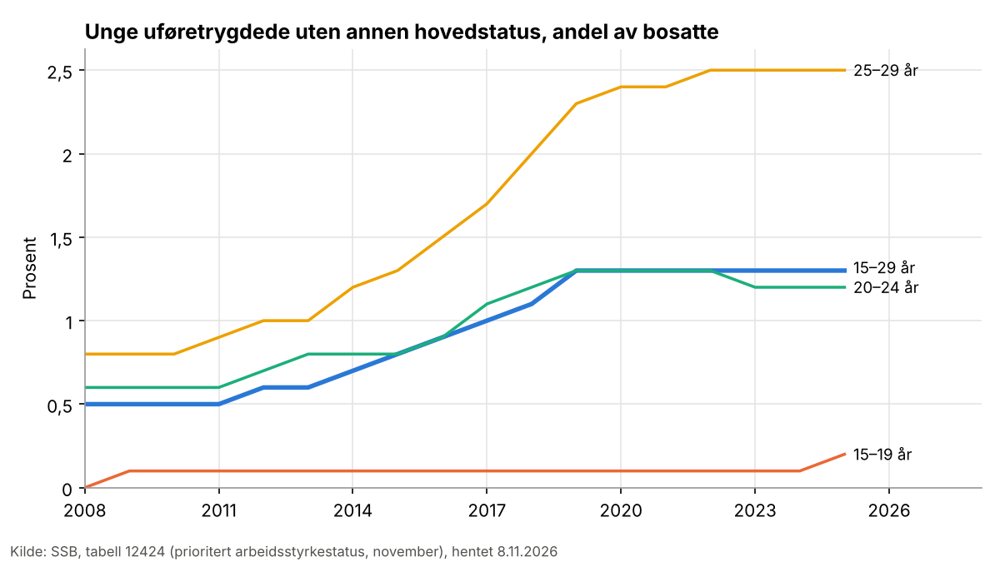
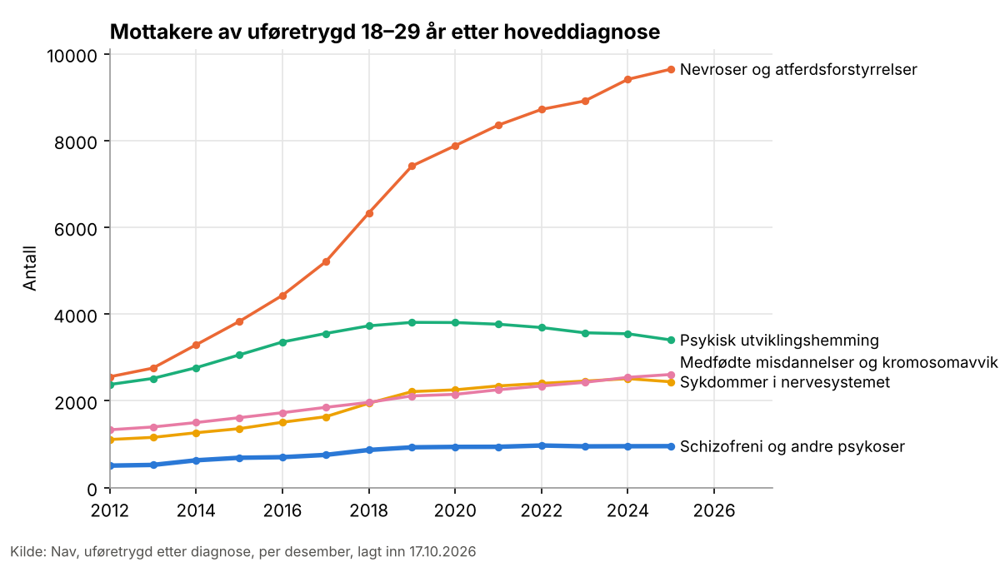
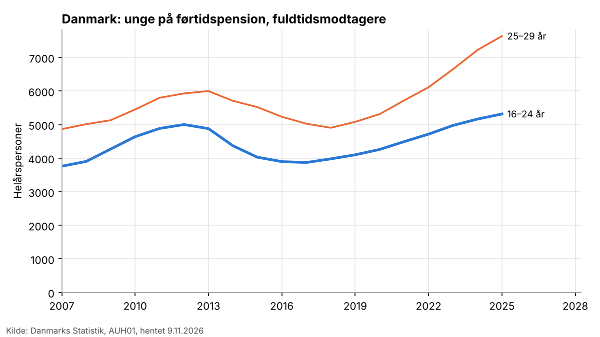

# Hvorfor blir flere unge uføre? Utviklingen i Norge siden 2010, sammenlignet med Sverige og Danmark, og hva forskningen sier om driverne

Utkast, ukontrollert. Skrevet 9. november 2026 i en kaldtest av løypa for forskningsspørsmål. Svaret bygger på 127 valgte kilder. Av dem er 63 lest i fulltekst, 43 bare som sammendrag, og 21 har verken tekst eller sammendrag. Tallene fra kildene står med sitat og side i estimattabellen, og statistikken står med kilde og definisjon i statistikktabellen. Statistikken er beskrivende og viser ikke årsaker.

## Kort svar

Andelen unge med uføretrygd i Norge økte kraftig fra 2010 til 2019 og har siden ligget omtrent flatt på et høyt nivå. Blant 25–29-åringer var 2,2 prosent uføretrygdet i 2016 og 3,7 prosent i 2025, og økningen kom mest fram til 2021. Nesten hele økningen gjelder psykiske lidelser og atferdsforstyrrelser, og mest gruppen «nevroser og atferdsforstyrrelser», som blant annet omfatter angst og utviklingsforstyrrelser. Psykisk utviklingshemming utgjør en synkende andel.

Forskningen peker på flere drivere som virker sammen. Den sterkeste dokumentasjonen gjelder regelverket for arbeidsavklaringspenger (AAP): kortere makstid og strengere unntak fra 2018 førte flere unge raskere over på uføretrygd (og flere i aktivitet), og Navs analyser tilskriver to tredeler av økningen i nye unge uføre fra 2011–2013 til 2015–2019 unge som hadde nådd makstiden. Studiene viser at regelverket styrte når unge ble uføre, men ikke om de ellers ville blitt uføre senere, og en jevn vekst blant unge uten AAP tyder på at også andre forhold virker. Unge som blir uføre har oftere ikke fullført videregående enn før, og flere får en psykisk diagnose i ungdommen, men studiene av utdanning og psykisk helse justerer stort sett bare for observerbare kjennetegn. Kvasieksperimentelle studier viser at foreldres uføretrygd øker sjansen for at barna blir uføre, men effekten for befolkningen som helhet er trolig mindre enn sammenhengen tilsier, og at høy lokal ledighet ved inngangen til arbeidslivet øker risikoen senere for menn med svake ferdigheter. Disse studiene bygger på kull født før 1990. Ingen kilde i utvalget anslår hvor mye av den samlede økningen hver driver forklarer.

Sverige og Danmark har hatt en annen utvikling, fordi begge strammet inn. I Sverige ble andelen avslag på aktivitetsersättning doblet fra 2016 til 2018, og antallet med ersättningen falt fra drøyt 32 000 i 2016 til om lag 24 000 i 2019. I Danmark stengte reformen i 2013 i praksis førtidspension for de fleste under 40 år, og nye tilkendelser til unge falt med to tredeler. Andelen unge danske på førtidspension har likevel økt igjen etter 2018. Tallene fra de tre landene måles ulikt og kan ikke sammenlignes direkte.

## Statistikk

### Norge

Nav og SSB måler unge uføre på to måter. Nav teller alle mottakere ved utgangen av året som andel av befolkningen i aldersgruppen. SSBs tabell over prioritert arbeidsstyrkestatus teller unge 15–29 år i november, og uføretrygdede som også er i arbeid, utdanning, på tiltak eller mottar AAP, plasseres der. SSB-tallene er derfor lavere, men serien går tilbake til 2008.

- **Lang serie (SSB, tabell 12424):** Blant unge 15–29 år var 0,5 prosent uføretrygdet uten annen hovedstatus i 2010, 0,8 prosent i 2015 og 1,3 prosent i 2019. Andelen var den samme i 2025. Blant 25–29-åringer økte den fra 0,8 prosent i 2010 til 2,3 prosent i 2019 og 2,5 prosent i 2025, og blant 20–24-åringer fra 0,6 til 1,2 prosent. Regnes uføretrygdede som er sysselsatt med, økte andelen 15–29-åringer fra 0,55 prosent i 2010 til 1,47 prosent i 2025.
- **Alle mottakere (Nav):** Fra 2016 til 2025 økte andelen uføretrygdede fra 1,0 til 1,3 prosent blant 18–19-åringer, fra 1,5 til 2,1 prosent blant 20–24-åringer og fra 2,2 til 3,7 prosent blant 25–29-åringer. For 25–29-åringene var andelen 3,6 prosent allerede i 2021. Økningen var større for kvinner (fra 2,0 til 3,7 prosent) enn for menn (fra 2,3 til 3,7 prosent), så kjønnsforskjellen i denne aldersgruppen er borte. Blant 20–24-åringer er andelen fortsatt høyere for menn (2,3 prosent) enn for kvinner (1,8 prosent).
- **Nye mottakere (Nav):** Antall nye uføre per 1000 ikke-uføre 25–29-åringer økte fra 3,4 i 2016 til 6,5 i 2019 og falt til 4,2 i 2025. For 20–24-åringer var tallene 3,0, 4,4 og 3,1. Blant 18–19-åringer har tilgangen økt nesten jevnt, fra 6,7 i 2016 til 8,2 i 2025.
- **Antall:** Antallet uføre 18–29 år var 9954 i desember 2012 og 22213 i desember 2025, en økning på 12259.

- **Diagnoser (Nav):** Psykiske lidelser og atferdsforstyrrelser var hoveddiagnosen for 58,9 prosent av de unge uføre i 2012 og 69,2 prosent i 2025. Antallet med slike diagnoser økte fra 5865 til 15378, og det står for 78 prosent av hele økningen. Gruppen nevroser og atferdsforstyrrelser alene økte fra 2556 til 9647 og står for 58 prosent av økningen. Andelen med psykisk utviklingshemming falt fra 23,9 til 15,3 prosent, selv om antallet økte fra 2378 til 3404. Medfødte misdannelser og kromosomavvik utgjorde 11,7 prosent i 2025.

### Danmark

- **Førtidspension (Danmarks Statistik, AUH01 og FOLK1A):** Danmarks Statistik måler fuldtidsmodtagere, altså helårspersoner, ikke personer per dato som Nav. Målt slik var 1,75 prosent av 25–29-åringene på førtidspension i 2010 og 1,86 prosent i 2013. Etter reformen i 2013 falt andelen til 1,27 prosent i 2018, men den var tilbake på 1,88 prosent i 2025. Blant 16–24-åringer var andelen 0,77 prosent i 2010, 0,59 prosent i 2018 og 0,80 prosent i 2025. Antallet fuldtidsmodtagere 25–29 år var 7639 i 2025.
- **Sammenlignet med Norge:** Andelen unge danske 25–29 år på førtidspension i 2025 er om lag halvparten av den norske andelen målt av Nav (3,7 prosent). Målene er ulike, så sammenligningen er grov.

### Sverige

Datakatalogen og den svenske statistikkdatabasen til Försäkringskassan ga ikke maskinlesbare tall for unge med aktivitetsersättning. Tallene her er derfor hentet fra rapportene (se under).

## Norge: nivå og utvikling i forskningen og Navs analyser

- **Lang sikt:** Andelen under 30 år med uføretrygd økte ganske jevnt fra 0,8 prosent i 1992 til 1,7 prosent i 2016. Uten økningen i tilgangen blant 18-åringer etter 2000 ville andelen 18–29 år vært litt over 1,4 prosent i 2016. ([Bragstad 2018, *Arbeid og velferd*](https://www.nav.no/no/nav-og-samfunn/kunnskap/analyser-fra-nav/arbeid-og-velferd/arbeid-og-velferd/vekst-i-uforetrygding-blant-unge))
- **Fra 2013 til 2022:** Antallet uføre 18–29 år økte fra 10 400 (1,3 prosent av aldersgruppen) i 2013 til 20 100 (2,4 prosent) i 2019. I 2022 var det 21 800 (2,6 prosent), omtrent som året før. ([Lande 2023, *Arbeid og velferd*](https://www.nav.no/no/nav-og-samfunn/kunnskap/analyser-fra-nav/arbeid-og-velferd/arbeid-og-velferd/arbeid-og-velferd-nr.1-2023/hvorfor-sa-sterk-uforevekst-blant-unge-i-arene-2014--2019)) Andelen var 1,2 prosent i 2010. ([Aarbakke mfl. 2020, Oslo Economics og Frischsenteret](https://kudos.dfo.no/dokument/c48cd033-8718-4bb3-a149-7bc9f67459cf))
- **Andel av alle nye uføre:** Unge 18–29 år utgjorde 13 prosent av alle nye uføretrygdede i 2022, mot 9 prosent i 2015. ([Bragstad 2023, *Arbeid og velferd*](https://www.nav.no/no/nav-og-samfunn/kunnskap/analyser-fra-nav/arbeid-og-velferd/arbeid-og-velferd/arbeid-og-velferd-nr.2-2023/unge-i-nav-fra-arbeidsavklaringspenger-til-uforetrygd))
- **Geografi og bakgrunn:** I 2021 varierte andelen 18–29-åringer med uføretrygd fra 1,3 prosent i Oslo til 3,8 prosent i Vestfold og Telemark. Unge innvandrere har lavere andel (1,5 prosent) enn norskfødte. Andelen økte med 100 prosent eller mer i alle fylker fra 2012 til 2021, mest i Nordland (129 prosent). ([Kalstø og Danielsen 2022, *Arbeid og velferd*](https://www.nav.no/no/nav-og-samfunn/kunnskap/analyser-fra-nav/arbeid-og-velferd/arbeid-og-velferd/arbeid-og-velferd-nr.3-2022/store-fylkesforskjeller-i-unge-ufore)) Blant unge utenfor arbeid og utdanning var 15 prosent uføretrygdet i de minst sentrale kommunene og 8 prosent i de mest sentrale i 2021. ([NORCE 2022](https://nva.sikt.no/registration/0198cc84729b-a09bd70a-765d-4bbb-a164-84a96be028c2))
- **Bytte mellom ytelser:** Veksten i unge på AAP etter 2010 var i hovedsak et bytte fra sykepenger til AAP. Ser man langtidssykefravær og AAP under ett, var utviklingen for unge under 30 år lik den for eldre. ([Kann og Grønlien 2021](https://www.nav.no/no/nav-og-samfunn/kunnskap/analyser-fra-nav/arbeid-og-velferd/arbeid-og-velferd/arbeid-og-velferd-nr.1-2021/Midlertidige%20helserelaterte%20ytelser%20til%20unge%20%E2%80%93%20har%20vi%20misforst%C3%A5tt%20utviklingen))
- **Veien inn:** Om lag en tredel (34 prosent) av de nye uføre under 30 år i 2020 kom direkte, uten sykepenger eller AAP først (tallet er gjengitt fra et annet Nav-notat), og antallet som kommer direkte er 30 prosent høyere enn i 2000–2013. ([Kann og Grønlien 2021, *Arbeid og velferd*](https://www.nav.no/no/nav-og-samfunn/kunnskap/analyser-fra-nav/arbeid-og-velferd/arbeid-og-velferd/arbeid-og-velferd-nr.1-2021/Midlertidige%20helserelaterte%20ytelser%20til%20unge%20%E2%80%93%20har%20vi%20misforst%C3%A5tt%20utviklingen)) Rundt 90 prosent av 20–29-åringene som fikk uføretrygd, hadde vært på minst ett arbeidsrettet tiltak, i om lag to år samlet. ([Aarbakke mfl. 2020](https://kudos.dfo.no/dokument/c48cd033-8718-4bb3-a149-7bc9f67459cf))
- **Fra AAP til uføretrygd:** Blant 18–19-åringer som startet på AAP i 2012, var sannsynligheten for uføretrygd innen ti år nærmere 60 prosent, og 35–40 prosent for 20–29-åringene. Det er høyere enn for dem som startet på en midlertidig helseytelse i 1993–2008. ([Bragstad 2023](https://www.nav.no/no/nav-og-samfunn/kunnskap/analyser-fra-nav/arbeid-og-velferd/arbeid-og-velferd/arbeid-og-velferd-nr.2-2023/unge-i-nav-fra-arbeidsavklaringspenger-til-uforetrygd)) Blant unge som kom inn på en midlertidig helseytelse, kom 70 prosent fra «annet» og ikke fra sykepenger. ([Kann og Kristoffersen 2015, *Arbeid og velferd*](https://www.nav.no/no/nav-og-samfunn/kunnskap/analyser-fra-nav/arbeid-og-velferd/arbeid-og-velferd/arbeidsavklaringspenger-helt-forskjellig-fra-forloperne))
- **Kohorter:** Blant dem som ble uføre i ung voksen alder (29–39 år ved slutten av kohorten), økte andelen uten fullført videregående fra 50,1 prosent i 2003-kohorten til 62,3 prosent i 2014-kohorten. ([Wittlund mfl. 2022](https://openalex.org/W4220875817)) Andelen unge AAP-mottakere som fulgte et forløp som endte i varig uføretrygd, ble tredoblet fra 2004- til 2014-kohorten. ([Wittlund og Lorentzen 2023](https://openalex.org/W4385349285))

## Sverige: nivå og utvikling

- **Aktivitetsersättning:** 29 000 personer fikk aktivitetsersättning i løpet av 2005, og drøyt 47 000 i 2015. Om lag 70 prosent har en psykiatrisk diagnose, og 60 prosent hadde som barn et pleiebehov som ga foreldrene rett til vårdbidrag. ([Försäkringskassan 2017](https://www.ForsakringsKassan.SE/download/18.3a5418591814e228e4413ae/1661265663910/unga-i-aktivitetsersattning-korta-analyser-2017-3.pdf)) Nye mottakere per 1000 unge 19–29 år økte fra 3,5 i 2005 til om lag 6,2 i 2015. ([Jablonska mfl. 2019](https://openalex.org/W2929109866), tallet er gjengitt fra en annen kilde)
- **Innstramming fra 2016:** Andelen avslag på nye søknader om aktivitetsersättning ved nedsatt arbeidsevne ble doblet, fra 24 prosent i 2016 til 47 prosent i 2018, og avslagene på søknader om forlengelse økte fra 5 til 20 prosent. Inspektionen for socialförsäkringen knytter økningen til endret praksis i Försäkringskassan, og sannsynligheten for avslag økte med 5,77 prosentpoeng etter at Försäkringskassans interne rettslige kvalitetsoppfølging ble publisert. Antallet 19–29-åringer med ersättningen falt fra drøyt 32 000 i 2016 til om lag 24 000 i 2019. ([Inspektionen för socialförsäkringen 2020](https://publikt.se/sites/publikt/files/2020-12/Rapport%202020-9%20Variationen%20inom%20aktivitetsers%C3%A4ttningen.pdf))
- **Etter 2020:** I desember 2022 hadde knapt 29 700 unge 19–29 år aktivitetsersättning ved nedsatt arbeidsevne. 67 prosent hadde en psykiatrisk hoveddiagnose og 47 prosent en nevropsykiatrisk diagnose. Av unge under 30 år med sjuk- eller aktivitetsersättning i 2024 hadde knapt 9 prosent sjukersättning. ([Försäkringskassan 2024](https://forsakringskassan.se/download/18.2226b322192cb581db411b/1730888074115/analys-av-aktiviteter-under-tid-med-aktivitetsersattning-svar-regeringsuppdrag-dnr-2023-019274.pdf))
- **Etter 30 år:** 53 prosent av dem som gikk ut av aktivitetsersättningen ved 30 år i 2022–2023, fikk sjukersättning innen et halvår, og 52 prosent året etter. Etter en periode med aktivitetsersättning begynte om lag fire prosent å arbeide. ([Försäkringskassan 2024](https://forsakringskassan.se/download/18.2226b322192cb581db411b/1730888074115/analys-av-aktiviteter-under-tid-med-aktivitetsersattning-svar-regeringsuppdrag-dnr-2023-019274.pdf); [Försäkringskassan 2025](https://www.forsakringskassan.se/download/18.5027cb6019705cd0bf2189/1750247606910/uppdrag-om-unga-med-aktivitetsersattning-och-personer-med-sjukpenning-i-sarskilda-fall-svar-regeringsuppdrag-dnr-2025-000538.pdf)) I 2015 gikk 48 prosent direkte over. ([Försäkringskassan 2017](https://www.ForsakringsKassan.SE/download/18.3a5418591814e228e4413ae/1661265663910/unga-i-aktivitetsersattning-korta-analyser-2017-3.pdf))
- **Uførepensjon for vanlige psykiske lidelser blant unge ansatte** falt etter innstrammingen i 2008: blant offentlig ansatte manuelle arbeidere var raten 80 per 100 000 i 2004-kohorten, 13 i 2009-kohorten og 23 i 2014-kohorten. ([Amin mfl. 2023](https://openalex.org/W4323066482))

## Danmark: nivå og utvikling

- **Reformen i 2013:** I 2012 ble knapt 325 unge under 40 år tilkjent førtidspension per måned, i 2015 godt 115. Beskæftigelsesministeriets analyse anslår at mer enn 11 prosent av dem som ble førtidspensjonert før reformen, ville hatt større tilknytning til arbeid eller utdanning uten pensjonen, og at merovergangen var 28 prosentpoeng for dem som ble pensjonert etter ett til to års ledighet. ([Philip mfl. 2016](https://bm.dk/media/5955/analyse-af-effekterne-af-foertidspensionreformen-for-kontanthjaelpsmodtagere-under-40-aar.pdf))
- **Diagnoser:** I en sammenligning av sju europeiske land var psykiske lidelser og atferdsforstyrrelser den vanligste diagnosen blant unge 19–29 år på uføreytelser, fra 58 prosent i Storbritannia til 80 prosent i Danmark. Antallet unge på uføreytelser økte i alle landene. ([Kaltenbrunner Bernitz mfl. 2013](https://openalex.org/W1967551067), bare sammendrag)

## Drivere

### Regelverket for AAP

- **Makstid:** Navs dekomponering viser at unge som hadde nådd makstiden på AAP, sto for 66 prosent av økningen i årlig antall nye unge uføre fra 2011–2013 til 2015–2019, og for 81 prosent av nedgangen fra 2019 til 2020. ([Lande 2023](https://www.nav.no/no/nav-og-samfunn/kunnskap/analyser-fra-nav/arbeid-og-velferd/arbeid-og-velferd/arbeid-og-velferd-nr.1-2023/hvorfor-sa-sterk-uforevekst-blant-unge-i-arene-2014--2019))
- **Kortere makstid i 2018:** Unge 18–29 år som fikk AAP i januar 2018 med tre års makstid, hadde etter drøyt fire år 74 prosent flere mottakere av uføretrygd enn de som fikk AAP i desember 2017 med fire års makstid. Det er en relativ økning. Målt i prosentpoeng var effekten nokså lik på tvers av aldersgruppene. Den kortere makstiden ga også 9,4 prosentpoeng flere unge i arbeid, kurs eller utdanning, så reformen førte unge både raskere i aktivitet og raskere over på uføretrygd. ([Myhre og Kann 2022, *Arbeid og velferd*](https://www.nav.no/no/nav-og-samfunn/kunnskap/analyser-fra-nav/arbeid-og-velferd/arbeid-og-velferd/arbeid-og-velferd-nr.2-2022/kortere-makstid-pa-aap-ga-flere-i-arbeid-og-raskere-uforetrygd)) Et annet anslag, gjengitt i Fafo-rapporten, er at sannsynligheten for uføretrygd ni år etter innvilgelse øker med 0,8–1,2 prosent per måned kortere makstid, men det er ikke robust. ([Strand og Svalund 2021](https://kudos.dfo.no/dokument/f0f528eb-0eaf-4e6b-bcb1-5b5b44367324))
- **Strengere unntak i 2018:** For AAP-mottakere som nådde fireårsgrensen etter innstrammingen, økte andelen på uføretrygd tolv måneder senere med 11 prosentpoeng, og for dem under 30 år økte også andelen på sosialhjelp med 6 prosentpoeng. ([Lima og Grønlien 2020, *Arbeid og velferd*](https://www.nav.no/no/nav-og-samfunn/kunnskap/analyser-fra-nav/arbeid-og-velferd/arbeid-og-velferd/arbeid-og-velferd-nr.2-2020/flere-mottar-uforetrygd-og-sosialhjelp-etter-innstramming-i-aap-regelverket))
- **Lavere minstesats og avviklet ung ufør-tillegg i 2020:** Frischsenteret og Proba anslår at endringene for AAP-mottakere under 25 år ga rundt 5–6 prosent færre nye AAP-tilfeller blant unge med lav inntekt. Med 2019 som referanseår i stedet for snittet 2013–2019 blir anslaget om lag dobbelt så stort (369 færre tilfeller i 2020), men ingen av anslagene skiller seg fra den vanlige variasjonen fra år til år, så nedgangen kan være tilfeldig. Studien fant ingen klare endringer i overgangen fra AAP til uføretrygd, arbeid eller utdanning. Det er en svak antydning til at 18–23-åringer ble raskere avklart til uføretrygd, men forskjellene er små og usikre. Reformen falt sammen med pandemien. ([Hernæs mfl. 2023, Frisch-rapport 5/2023](https://bibliotek.nav.no/record/4593))
- **Tolkning:** Studiene viser at regelverket påvirket når unge kom over på uføretrygd. Toppen i nye unge uføre i 2018–2019 og fallet i 2020 henger sammen med makstiden. Men de viser ikke om de samme unge ellers ville blitt uføre senere, og Nav skriver selv at det ikke besvares. Antallet nye unge uføre som ikke har hatt AAP, de fleste under 20 år, har også vokst jevnt, og Nav tolker det som tegn på mer grunnleggende, saktegående samfunnsendringer. ([Lande 2023](https://www.nav.no/no/nav-og-samfunn/kunnskap/analyser-fra-nav/arbeid-og-velferd/arbeid-og-velferd/arbeid-og-velferd-nr.1-2023/hvorfor-sa-sterk-uforevekst-blant-unge-i-arene-2014--2019))

### Psykiske lidelser og diagnostisering

- **Flere diagnoser:** I kullet som fylte 21 år i 2018, hadde 37 prosent fått en psykisk diagnose hos fastlege eller i spesialisthelsetjenesten i alderen 15–21 år, mot 33 prosent i kullet fra 2014. ([Aarbakke mfl. 2020](https://kudos.dfo.no/dokument/c48cd033-8718-4bb3-a149-7bc9f67459cf))
- **Diagnosepraksis:** I kommuner der legene diagnostiserer psykiske lidelser oftere, er sannsynligheten for AAP eller uføretrygd ved 24 år høyere: ett standardavvik mer diagnostisering hang sammen med 0,006–0,008 høyere sannsynlighet. Analysen bruker variasjon mellom kommuner og viser at diagnostisering kan påvirke trygdebruken, men ikke at diagnosene er feil. ([Aarbakke mfl. 2020](https://kudos.dfo.no/dokument/c48cd033-8718-4bb3-a149-7bc9f67459cf), kapittel av Markussen og Røed)
- **Lang sikt:** Tilgangen av nye uføre 25–29 år med psykiske lidelser utenom psykisk utviklingshemming økte fra 40 til 130 per 100 000 fra 1977 til 2012. Blant 18–19-åringer økte den til over 100 per 100 000. ([Brage og Thune 2015, *Arbeid og velferd*](https://www.nav.no/no/nav-og-samfunn/kunnskap/analyser-fra-nav/arbeid-og-velferd/arbeid-og-velferd/ung-uforhet-og-psykisk-sykdom))
- **Psykisk helse i ungdommen og senere ytelser:** Young-HUNT og andre norske kohorter viser at psykiske plager i ungdommen gir høyere risiko for helserelaterte ytelser som ung voksen. I en søskensammenligning var oddsen for slike ytelser 1,65 ganger høyere per poeng på en skala for angst og depresjon. ([Pape mfl. 2012](https://openalex.org/W2160015399), bare sammendrag) Blant unge som hadde fullført videregående ved 21 år, hadde de med en depresjonsdiagnose ved 22–26 år 4,43 ganger så høy risiko for uføretrygd ved 29 år. Studien justerer for observerbare kjennetegn. ([Hetlevik mfl. 2023](https://openalex.org/W4366083399))
- **Utviklingsforstyrrelser i Sverige:** Unge 19–29 år med en ny ADHD-diagnose hadde ti ganger så høy risiko for uførepensjon innen fem år som en sammenligningsgruppe, og ni ganger så høy som søsken uten ADHD (hasardratio 9,0). ([Helgesson mfl. 2021](https://openalex.org/W3186518967)) Unge menn med autisme hadde mange ganger flere dager med sykefravær og uførepensjon enn kontrollgruppen. ([Virtanen mfl. 2020](https://openalex.org/W3007697702))
- **Unge kvinner:** Psykiske plager økte kraftig blant ungdom og unge voksne i HUNT fra 1995–1997 til 2017–2019, mest mellom de to siste rundene. Andelen unge kvinner med depresjonssymptomer over grenseverdien var 10,7 prosent i 2017–2019, høyest av alle grupper. Studien er beskrivende. ([Krokstad mfl. 2022](https://openalex.org/W4280593459))

### Utdanning og frafall

- **Fullført videregående:** Blant dem som ble uføre som 25–29-åringer, falt andelen med fullført videregående fra 40 til 20 prosent fra 2000 til 2017. ([Aarbakke mfl. 2020](https://kudos.dfo.no/dokument/c48cd033-8718-4bb3-a149-7bc9f67459cf))
- **Frafall og ytelser:** I Young-HUNT var risikoen for langvarig sykefravær eller uførepensjon 15 prosentpoeng høyere blant dem som ikke fullførte videregående, også etter justering for helse og foreldrenes sosioøkonomi. ([De Ridder mfl. 2013](https://openalex.org/W2127924530)) I en masteroppgave var vitnemål fra videregående forbundet med 4,1 prosentpoeng lavere sannsynlighet for uføretrygd ni år senere for kullet født 1990, men studien justerer bare for observerbare kjennetegn. ([Bergaust 2024, masteroppgave](https://nva.sikt.no/registration/019909c23973-ea65712e-ebc7-454b-b8df-def7f6bf6e87))
- **Årsak eller seleksjon:** En studie av utvidet obligatorisk skole på 1960-tallet finner ingen klar effekt av ett ekstra skoleår på uførepensjon ved 50 år. ([Brinch og Galloway 2013](https://openalex.org/W604728786)) I Sverige ble sammenhengen mellom svake skoleresultater og uføreytelse for psykiske lidelser sterkere for nyere avgangskull. ([Jablonska mfl. 2019](https://openalex.org/W2929109866))

### Arbeidsmarkedet for unge

- **Lokal ledighet:** For menn født 1959–1973 med lave evner målt på sesjon ga ett prosentpoeng høyere lokal ledighet ved 16 år om lag 20 prosent (relativt) høyere sannsynlighet for uførepensjon ved 35 år. ([Haaland 2016](https://openalex.org/W2212575307))
- **Jobbtap:** Blant menn i alle aldre kan 28 prosent av nye uføretrygdkrav tilskrives tap av jobb ved nedleggelser. ([Bratsberg mfl. 2010](https://openalex.org/W1562236787), arbeidsnotat)
- **Skjult ledighet:** Flere kilder diskuterer om helserelaterte ytelser fanger opp unge som ellers ville vært ledige, men de er bare lest som sammendrag (se forbehold).

### Familiebakgrunn

- **Overføring mellom generasjoner:** Når en forelder som har anket et avslag, får innvilget uføretrygd fordi saken tilfeldig havnet hos en mild dommer, øker sannsynligheten for at det voksne barnet mottar uføretrygd med 6 prosentpoeng over fem år og 12 prosentpoeng etter ti år. ([Dahl mfl. 2014](https://openalex.org/W2104893223)) En annen norsk studie med grenseestimater for hele befolkningen finner at den gjennomsnittlige årsakseffekten av foreldres uføretrygd på barnas er høyst 2,8 prosentpoeng. Forfatterne skriver at effektene er betydelig lavere enn korrelasjonen mellom generasjoner og lavere enn de kvasieksperimentelle anslagene, som gjelder familier på grensen til å få uføretrygd. ([de Haan og Schreiner 2018](https://openalex.org/W3123524712)) I Nederland reduserte en innstramming for foreldrene barnas egen bruk av uføretrygd med 11 prosent. ([Dahl og Gielen 2021](https://openalex.org/W2786011848), bare sammendrag)
- **Foreldres ytelser og bakgrunn:** Unge 20–29 år i HUNT hadde 2,16 ganger så høy odds for medisinske ytelser når foreldrene hadde mottatt slike ytelser. ([Pape mfl. 2013](https://openalex.org/W2102173634), bare sammendrag) Jenter født 1989–1991 fra den laveste sosiale klassen hadde 9 prosentpoeng høyere sannsynlighet for uføretrygd eller AAP ved 26 år. ([Delalic 2020, masteroppgave](https://nva.sikt.no/registration/019c9524cfcc-39907780-0d56-4239-9b5d-80237da5e2eb))
- **Sammensetning eller atferd:** En dekomponering av uførerisikoen for 25–34-åringer i 1996 og 2019 (fra 1,66 til 3,53 prosent) tilskriver økningen endrede sammenhenger og ikke endret sammensetning av gruppen. ([Sørlie 2022, masteroppgave](https://nva.sikt.no/registration/0198f22710a7-9891d74a-fefc-44a0-927c-96a4a3d8525a))

## Oversikter

Utvalget har ingen systematisk oversikt over hvorfor flere unge blir uføre. Rapporten fra Oslo Economics og Frischsenteret (2020), bestilt av Arbeids- og sosialdepartementet, er den bredeste norske gjennomgangen og kombinerer registeranalyser og litteratur. Navs analyser i *Arbeid og velferd* fyller samme rolle for utviklingen etter 2020. OECDs landrapporter om psykisk helse og arbeid (2013) og *Investing in Youth: Norway* (2018) og en nordisk sammenligning fra 2018 er valgt, men er ikke lest i fulltekst.

## Forbehold

- **Danske kilder er tynne.** Utover Danmarks Statistik og Beskæftigelsesministeriets analyse fra 2016 bygger Danmark-delen på sammendrag. Danske rapporter på eget språk (STAR, VIVE, Ankestyrelsen) dekkes dårlig av søket, og Ankestyrelsens tendensrapport og en ny analyse av reformen i 2013 har ikke tekst.
- **De nyeste arbeidsnotatene og kapitlene kan mangle.** Navs kapittel fra 2026 om unge utenfor arbeid og utdanning med helseytelser og tre artikler i *Søkelys på arbeidslivet* er valgt, men teksten kunne ikke hentes.
- **Tallene fra landene er ikke sammenlignbare.** Nav teller personer per dato, Danmarks Statistik helårspersoner, og de svenske tallene gjelder aktivitetsersättning, som har en egen variant for forlenget skolegang. Ingen harmonisert kilde med tall for alle tre landene etter 2015 er lest.
- **Driverne er ikke skilt fra hverandre.** Bare regelverket for AAP og overføringen mellom generasjoner er studert med sterkt design. Diagnosene beskriver hvem som blir uføre, ikke hvorfor flere får diagnosene.
- **Sammendrag og masteroppgaver:** 43 kilder er bare lest som sammendrag, og fire masteroppgaver er med. Ett tall er fra et arbeidsnotat.
- **Utvalget er mettet** etter løypas regler (se `metning.md`), men det første blinde utvalget fant mange sterke kilder søket hadde oversett.
- **Ikke kontrollert av fagperson.**

## Kunnskapshull og mulige egne analyser

- **Hvor mye forklarer hver driver?** Ingen kilde dekomponerer økningen etter 2010 samlet etter diagnose, utdanning, regelverk og familiebakgrunn. Med registerdata i microdata.no kan økningen fra 2010 til 2025 brytes ned etter fullført videregående, foreldrenes trygdebruk, bosted og AAP-historikk. Aktuelle registre er Navs registre over uføretrygd og AAP, utdanningsregisteret og befolkningsregisteret med koblingen til foreldre. Variablene må finnes i katalogen på microdata.no, og en slik dekomponering viser sammensetning, ikke årsaker. Forslaget er et utkast.
- **Etter 2022:** Effekten av at AAP-reglene ble reversert i 2022 på overgangen til uføretrygd blant unge er ikke studert i utvalget. Den samme koblingen i microdata.no kan følge kohorter som startet på AAP før og etter endringen.
- **Nordisk sammenligning:** Det finnes ingen nyere sammenligning av unge uføre i Norge, Sverige og Danmark med samme mål. Det må gjøres med nasjonal statistikk og tydelige definisjoner.

## Vedlegg

- Vedlegg A, kildeoversikt: [vedlegg-kilder.md](vedlegg-kilder.md)
- Kilder som må hentes for hånd: [mangler.md](mangler.md)
- Utvalg og metning: [utvalg.md](utvalg.md), [metning.md](metning.md)
